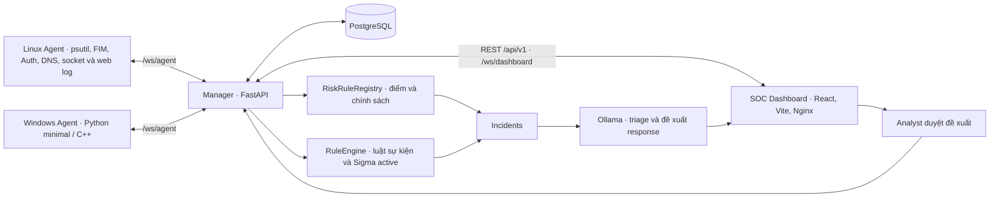

# HƯỚNG DẪN SỬ DỤNG HỆ THỐNG LAN ACTIVE RESPONSE MANAGER (LARP)

Chào mừng bạn đến với **LAN Active Response Platform (LARP)** – Hệ thống giám sát an ninh mạng nội bộ toàn diện, phân tích rủi ro theo thời gian thực (Real-time Telemetry Risk Assessment), tự động phát hiện chuỗi tiến trình độc hại và kích hoạt phản ứng phòng vệ chủ động (Active Response).

Tài liệu này cung cấp hướng dẫn vận hành chi tiết dành cho Chuyên viên Quản trị Hệ thống (SysAdmin) và Kỹ sư Phân tích Trung tâm Điều hành An ninh Mạng (SOC Analyst).

---

## 📑 MỤC LỤC
1. [Tổng Quan Kiến Trúc & Các Phân Hệ Chính](#1-tổng-quan-kiến-trúc--các-phân-hệ-chính)
2. [Hướng Dẫn Đọc Số Liệu & Nhận Diện Nguy Cơ](#2-hướng-dẫn-đọc-số-liệu--nhận-diện-nguy-cơ)
   - [2.1. Đánh Giá Điểm Rủi Ro (Risk Score)](#21-đánh-giá-điểm-rủi-ro-risk-score)
   - [2.2. Phân Tích Lưu Lượng Mạng (Network Traffic & Flow Data)](#22-phân-tích-lưu-lượng-mạng-network-traffic--flow-data)
   - [2.3. Cây Tiến Trình (Process Tree) & Cơ Chế Lọc Zombie](#23-cây-tiến-trình-process-tree--cơ-chế-lọc-zombie)
   - [2.4. Quản Lý Sự Cố (Incidents & FIM Alerting)](#24-quản-lý-sự-cố-incidents--fim-alerting)
   - [2.5. Quản Lý Luật Phát Hiện (Detection Rules & Dynamic Process Chains)](#25-quản-lý-luật-phát-hiện-detection-rules--dynamic-process-chains)
3. [Hướng Dẫn Chi Tiết Các Trang Chức Năng Trên Giao Diện Web](#3-hướng-dẫn-chi-tiết-các-trang-chức-năng-trên-giao-diện-web)
   - [Dashboard](#31-dashboard-bảng-điều-khiển-tổng-quan)
   - [Agents Management](#32-agents-quản-lý-thiết-bị-máy-trạm)
   - [Alerts](#33-alerts-cảnh-báo-an-ninh)
   - [Incidents](#34-incidents-quản-lý-sự-cố)
   - [Process Tree & Threat Root Cause](#35-process-tree-cây-tiến-trình--gốc-rễ-đe-dọa)
   - [Detection Rules & Process Chains](#36-detection-rules-process-groups--process-chains)
   - [Risk Assessment](#37-risk-assessment-phân-tích-telemetry)
   - [Network 3D Topology](#38-network-sơ-đồ-mạng-3d--điều-phối-băng-thông)
   - [Commands & Active Response](#39-commands-phát-lệnh-điều-khiển)
   - [Whitelist & Settings](#310-whitelist--settings-cấu-hình-hệ-thống)
4. [Hướng Dẫn Chạy Các Kịch Bản Demo Thử Nghiệm Nhanh (Bash Scripts)](#4-hướng-dẫn-chạy-các-kịch-bản-demo-thử-nghiệm-nhanh-bash-scripts)
   - [Demo 1: File Integrity Monitoring (`demo_fim.sh`)](#demo-1-file-integrity-monitoring-demo_fimsh)
   - [Demo 2: Thu Thập Lưu Lượng Mạng Thật (`demo_network_traffic.sh`)](#demo-2-thu-thập-lưu-lượng-mạng-thật-demo_network_trafficsh)
   - [Demo 3: Cây Tiến Trình & Lọc Zombie (`demo_process_tree.sh`)](#demo-3-cây-tiến-trình--lọc-zombie-demo_process_treesh)
   - [Demo 4: Tự Phục Hồi Kết Nối & Watchdog (`demo_reconnect.sh`)](#demo-4-tự-phục-hồi-kết-nối--watchdog-demo_reconnectsh)
5. [Quy Trình Xử Lý Sự Cố Khẩn Cấp (SOP)](#5-quy-trình-xử-lý-sự-cố-khẩn-cấp-sop)
6. [Hướng Dẫn Vận Hành 6 Tính Năng SOC/EDR Nâng Cao Mới](#6-hướng-dẫn-vận-hành-6-tính-năng-socedr-nâng-cao-mới)
   - [6.1. Automated Threat Intelligence Feeds](#61-automated-threat-intelligence-feeds)
   - [6.2. YARA Signature Integration](#62-yara-signature-integration)
   - [6.3. Brute Force Detection](#63-brute-force-detection)
   - [6.4. DNS Tunneling & Shannon Entropy](#64-dns-tunneling--shannon-entropy)
   - [6.5. HTTP/TCP C2 Beaconing Detection](#65-httptcp-c2-beaconing-detection)
   - [6.6. Machine Learning Behavioral Baseline (Isolation Forest)](#66-machine-learning-behavioral-baseline-isolation-forest)
7. [Báo cáo rà soát mã nguồn](#7-báo-cáo-rà-soát-mã-nguồn)
8. [Bộ luật endpoint và xác thực](#8-bộ-luật-endpoint-và-xác-thực)

---

## 1. Tổng Quan Kiến Trúc & Các Phân Hệ Chính

LARP dùng mô hình Endpoint Agent → Manager → SOC Dashboard. Manager phát lệnh chiều ngược lại và Agent trả kết quả thực thi.



| Nguồn | Thu thập và truyền | Xử lý và lưu trữ |
| --- | --- | --- |
| Máy trạm | `HEARTBEAT` mang CPU, RAM, đĩa, IP và trạng thái. `PROCESS_LIST` định kỳ 20 giây mang PID, PPID, tên, exe, cmdline và mức sử dụng tài nguyên. | Agent Service cập nhật `agents`, `agent_history`, gửi lệnh chờ trong ACK. Snapshot vào `process_info` và đi qua Rule Engine. |
| Telemetry | `TELEMETRY_RISK` mỗi 15 giây mang tiến trình, kết nối và tín hiệu hệ thống. `ConnectionTracker` giữ lịch sử kết nối TCP theo socket và PID, với `first_seen`, `last_seen`, số lần quan sát và thời điểm tạo tiến trình nếu có. | Sigma xét các candidate active. Risk Registry tính điểm và lưu `risk_score_records`. Socket có IP/cổng đích đi vào `flows`. |
| Mạng và DNS | `FLOW_STATS` mỗi 5 giây lấy chênh lệch bộ đếm byte/gói qua psutil. DNS sniffer Linux theo dõi truy vấn DNS quan sát được trên interface cấu hình trong sniffer. | `flows` phục vụ điều tra mạng và dashboard. DNS đi cùng telemetry để luật DNS phân tích. Bộ đếm theo interface và snapshot socket có phạm vi khác nhau. |
| Toàn vẹn tệp | `FileIntegrityMonitor` lấy baseline SHA-256 khi khởi tạo. Mỗi 10 giây so trạng thái và gửi `FIM_ALERT` khi tệp được tạo, sửa hoặc xóa. Agent có đường quét YARA theo lệnh. | Handler FIM lưu `events`. Kết quả quét theo lệnh đi qua `YARA_SCAN_ALERT`. Cấu hình chữ ký nằm ở `yara_rules`. |
| Xác thực | `AuthMonitor` đọc phần mới từ các file log SSH/PAM và web theo offset. Đường chuyên dụng là `AUTH_EVENT`. | `auth_events` lưu service, IP, tài khoản, trạng thái, count và thời điểm. Risk Registry dùng dữ liệu auth để đánh giá brute force. |
| Web | `web_log_monitor.py` đọc nguồn Cloudflare Tunnel và file access log theo nguồn khả dụng, chuẩn hóa request rồi gửi `WEB_ACCESS_LOG`. | `web_access_logs` lưu request. Tín hiệu web đi qua rule event và risk rule đang được cấu hình. |
| Phản ứng | Manager đẩy lệnh qua WebSocket hoặc trả trong heartbeat. Agent thực thi cục bộ và gửi `COMMAND_ACK`. | `commands`, `response_actions`, `action_audit_logs` theo dõi vòng đời, snapshot, kết quả và rollback theo loại hành động. |

Các Agent Windows có bộ thu thập và lệnh được hỗ trợ riêng. Adapter Linux cho FIM, auth log và DNS cần quyền đọc các nguồn tương ứng. Capture DNS và socket phụ thuộc quyền, interface, namespace và chu kỳ lấy mẫu. Với reconnect, Agent thử lại từ 2 đến 15 giây và có watchdog theo heartbeat ACK.

Lịch sử phát triển ghi nhận bốn mốc chính. AI đi từ client Ollama và nhãn phản hồi đến triage, rồi đến đề xuất phản ứng có Analyst duyệt. Luồng containment bổ sung ACK phía Agent, cooldown, snapshot, rollback và tự bảo vệ Agent. Sau đó, AI SOC Studio thêm harvest/validation cùng vòng đời Sigma. Các lần xử lý cảnh báo giả trên desktop và dịch vụ remote dẫn tới việc lưu PID, executable và thời điểm tạo tiến trình, phân biệt socket mở mới với lần quan sát lặp và yêu cầu bằng chứng trước khi quy kết. Luồng web log mở rộng nguồn tín hiệu cho dịch vụ sau Cloudflare Tunnel.

### 1.1. Bản đồ mã nguồn và dữ liệu

| Phân hệ | Entry point và tệp cần đọc | Bảng hoặc dữ liệu |
| --- | --- | --- |
| Endpoint | `agent/agent.py`, `win_agent_minimal.py`, `win_agent_cpp/main.cpp`, `fim.py`, `auth_monitor.py`, `dns_sniffer.py`, `connection_tracker.py`, `web_log_monitor.py`, `commands/` trong thư mục `agent/`. | Snapshot tiến trình, socket, bộ đệm DNS và baseline hash trên Agent. |
| Ingestion | `manager/app/main.py`, `websocket/agent_ws.py`, `dashboard_ws.py`, `services/core/command_dispatcher.py`. | `agents`, `agent_history`, `process_info`, `flows`, `events`, `auth_events`, `web_access_logs`, `commands`. |
| Risk và detection | `services/detection/risk_assessment_service.py`, `services/detection/risk_rules/`, `services/rule_engine.py`. | `risk_score_records`, `detection_rules`, `process_groups`, `process_chain_rules`, `agent_baselines`, `whitelist_entries`, `system_settings`. |
| AI và vòng đời luật | `services/ai/{ai_client,ai_triage_service,ai_response_service,harvest_service,validation_service}.py`, `api/routes/{rules,dashboard}.py`, `routers/v1/incident_router.py`. | `rule_candidates`, `rule_versions`, `incidents`, `incident_notes`, `ai_analysis`. |
| Điều tra và containment | `services/incident/`, `services/response/`, `services/process/`, `services/detection/threat_intelligence_service.py`. | `response_policies`, `response_actions`, `action_audit_logs`, `agent_groups`, `agent_group_members`, `threat_feeds`, `threat_indicators`, bảng notification và báo cáo. |
| SOC UI | `frontend/src/App.jsx`, `routes/index.jsx`, `api/`, `hooks/`, `pages/`, `frontend/nginx.conf`. | REST cho truy vấn/trạng thái và `/ws/dashboard` cho cập nhật trực tiếp. |

Backend dùng Python, FastAPI, Pydantic v2, SQLAlchemy 2 async và asyncpg. PostgreSQL 16 là cơ sở dữ liệu trong Compose. Frontend dùng React 19, Vite, Axios, React Router và Chart.js. Docker Compose khởi chạy DB, Manager, Ollama, frontend/Nginx và Cloudflare Tunnel. Agent endpoint được triển khai riêng theo cấu hình Compose hiện tại. Ollama dùng model cấu hình bằng `AI_MODEL` (Compose đặt `sec-q6`).

### 1.2. Quy ước triển khai

- Đặt model SQLAlchemy, DTO Pydantic, truy vấn repository, nghiệp vụ service và REST/WS handler đúng lớp tương ứng. Các đường nhập liệu thời gian thực làm việc qua AsyncSession. Khi thay schema, rà cả `manager/alembic/`, `manager/scripts/migrate_*.py` và khởi tạo DB.
- Risk rule triển khai `evaluate(telemetry, context) → (score, reason)` trong `services/detection/risk_rules/` và đăng ký ở `__init__.py`. Giữ `rule_id` ổn định cho cấu hình DB, factors và UI. Rule Engine dùng `RuleMatch` cho luật sự kiện và dùng candidate/version cho Sigma theo luồng harvest → validation → analyst activate.
- Giữ các trường telemetry mới tùy chọn để tương thích Agent đang triển khai. `agent_id` theo endpoint, `pid` cần đối chiếu `process_start_time` khi có, timestamp dùng UTC. Dữ liệu không quan sát được cần được biểu diễn rõ trong kết quả điều tra.
- Dùng `manager/app/test/` cho unit/test handler, `manager/tests/integration/` cho API và DB, `agent/test_agent_features.py` cho hành vi Agent. Dùng fixture telemetry cho ca dương, ca âm và thiếu dữ liệu.

---

## 2. Hướng Dẫn Đọc Số Liệu & Nhận Diện Nguy Cơ

### 2.1. Đánh Giá Điểm Rủi Ro (Risk Score)

**Risk Score** trong `RiskAssessmentService` là điểm 0–100 do 19 strategy tính từ telemetry. Mỗi luật trả điểm theo chứng cứ và cấu hình, Manager nhân với trọng số, áp dụng debounce cho nhóm anomaly, cap nhóm anomaly rồi giới hạn tổng ở 100. `score` là điểm đã tổng hợp của chu kỳ. `smoothed_score` áp dụng EMA (alpha 0,35), có bypass cho điểm nghiêm trọng hoặc rule bảo mật đạt ngưỡng hiện hành. Cả hai được lưu cùng `factors`.

Cấu hình ngưỡng nằm ở Settings và `system_settings`. Mặc định từ `SettingService` gồm log 20, alert 50, alert với nút 70, tạo incident 50, fallback auto-isolate 85 và auto-kill 85. Khi điều tra, đối chiếu ngưỡng triển khai, chế độ monitor, whitelist và response policy. Các incident do Rule Engine ghi có `risk_score` theo severity của match (30/50/75/95) và đi theo đường tạo incident riêng.

**AI Confidence** thuộc `ai_analysis`, thang 0–1. Ollama nhận context và điểm sự cố có sẵn để tạo tóm tắt, nguyên nhân, phân loại và MITRE. AI Response Assist dựa trên triage để gợi ý phản ứng, Analyst chọn Apply hoặc Dismiss. Rule Harvest đề xuất Sigma từ CTI, Validation tính FPR/precision/recall/F1 trên tập kiểm định, Analyst quyết định Activate. Ba luồng AI phục vụ điều tra và quản lý luật, còn Risk Score đến từ engine xác định.

---

### 2.2. Phân Tích Lưu Lượng Mạng (Network Traffic & Flow Data)

Phân hệ Network Flow thu thập **dữ liệu lưu lượng thực tế** (`FLOW_STATS`) trực tiếp từ card mạng thông qua các delta đo lường giữa hai chu kỳ gửi:

- `bytes_sent`: Lượng byte gửi đi trong chu kỳ.
- `bytes_recv`: Lượng byte nhận về trong chu kỳ.
- `packets_sent`: Tổng số gói tin gửi đi.
- `packets_recv`: Tổng số gói tin nhận về.
- `tcp_packets_delta`, `udp_packets_delta` lấy từ bộ đếm giao thức hệ điều hành khi có. Agent dùng tỷ lệ ước tính khi thiếu số liệu. Dùng `packets_sent_delta` và `packets_recv_delta` để đọc tổng packet từ interface.

#### Cách nhận diện các hình thức tấn công mạng điển hình:

```
[1. TẤN CÔNG DoS / DDoS]
   Packets Rate: ──▲── (Tăng vọt hàng chục nghìn gói/giây)
   Kích thước gói: Nhỏ (SYN packet, UDP flood)
   -> Biểu đồ: Cột Packets tăng vọt dựng đứng, CPU agent tăng cao.

[2. ĐÁNH CẮP DỮ LIỆU (DATA EXFILTRATION)]
   Bytes Sent:   ──▲── (Tăng đột biến hàng trăm MB / GB gửi ra ngoài)
   Bytes Recv:   ───── (Gần như không đổi hoặc rất thấp)
   -> Biểu đồ: Chênh lệch rõ nét giữa Bytes Sent (rất cao) và Bytes Recv (rất thấp).

[3. DÒ QUÉT CỔNG / MẠNG (PORT SCAN / SYN SWEEP)]
   TCP Packets:  ──▲── (Hàng loạt gói SYN gửi tới nhiều cổng/IP đích)
   Bytes:        ─── (Bytes rất nhỏ do chỉ có cờ bắt tay SYN mà không truyền data)
   -> Biểu đồ: Tỷ lệ TCP packets/s cao bất thường nhưng tổng Bytes cực thấp.
```

---

### 2.3. Cây Tiến Trình (Process Tree) & Cơ Chế Lọc Zombie

Trang **Process Tree** giúp chuyên viên SOC phân tích cấu trúc cha-con của mọi tiến trình đang chạy:

1. **Gốc Cây Tiến Trình (Root Node PID 1)**:
   - Một PID cha thiếu có thể do giới hạn thu thập hoặc do tiến trình cha đã thoát. Khi điều tra, kiểm tra PPID và nguồn snapshot trước khi quy kết quan hệ cha-con.
2. **Cơ Chế Lọc Sạch Tiến Trình Zombie**:
   - Tiến trình Zombie (trạng thái `STATUS_ZOMBIE`, `defunct`) là tiến trình con đã kết thúc nhưng tiến trình cha chưa gọi hàm `wait()`.
   - Hàm `collect_process_info()` của Agent **chủ động loại bỏ** các tiến trình zombie này. Điều này giữ cho cây tiến trình luôn gọn gàng, không bị nghẽn giao diện bởi các tiến trình rác đã chết.
3. **Thao Tác Diệt Tiến Trình**:
   - **Kill Process**: Gửi tín hiệu `SIGKILL` tiêu diệt đúng PID chỉ định.
   - **Kill Process Tree**: Duyệt đệ quy và tiêu diệt đồng loạt toàn bộ nhánh tiến trình con và cháu của PID được chọn, ngăn chặn mã độc tự sinh lại (anti-respawn).

---

### 2.4. Quản Lý Sự Cố (Incidents & FIM Alerting)

Cơ chế **File Integrity Monitoring (FIM)** giám sát mã băm SHA-256 của các tệp tin quan trọng:
- `/etc/passwd`, `/etc/shadow`, `/etc/hosts` (Tệp hệ thống nhạy cảm)
- `/tmp/malware_sim/` (Thư mục kiểm thử mã độc)

#### Quy trình xử lý cảnh báo FIM:
1. **Lập Baseline Ban Đầu**: Khi Agent khởi động, toàn bộ mã băm SHA-256 ban đầu được lưu lại.
2. **Chống Gửi Cảnh Báo Trùng Lặp (State Transition Alerting)**:
   - Khi một file bị thay đổi (Modification), thêm mới (Creation), hoặc bị xóa (Deletion), Agent gửi đúng **01 gói tin cảnh báo duy nhất** (`FIM_ALERT`) và lập tức cập nhật lại hash mới.
   - Các chu kỳ quét tiếp theo sẽ không gửi lặp lại, tránh gây quá tải hộp thư SOC (Alert Flooding).
3. **Tự Động Tạo Sự Cố (Automatic Incident Creation)**:
   - Manager tạo incident **Critical** cho thay đổi được quan sát trên `/etc/passwd` hoặc `/etc/shadow`. Các tệp quản trị khác thuộc tập luật nhạy cảm có mức **High**. Incident lưu đường dẫn, thao tác và hash trước/sau.

---

### 2.5. Quản Lý Luật Phát Hiện (Detection Rules & Dynamic Process Chains)

Các luật hoạt động qua Risk Registry, Process Chain và Rule Engine. Danh sách dưới đây là 13 strategy ban đầu trong Risk Registry.

#### 13 strategy ban đầu
1. `cpu_spike`: Tăng vọt CPU đột biến.
2. `suspicious_process`: Khởi chạy công cụ tấn công (`mimikatz`, `nmap`, `netcat`, `nc`, `hydra`).
3. `network_connection`: Kết nối vượt ngưỡng số lượng port/kết nối.
4. `file_changes`: Tạo/sửa tệp hàng loạt (dấu hiệu Ransomware).
5. `process_chain`: Chuỗi tiến trình độc hại (ví dụ Word gọi PowerShell).
6. `injection`: Chèn mã tiến trình (`ptrace`, `/proc/self/mem`).
7. `living_off_land`: Lợi dụng tiện ích có sẵn của OS (LoLBins: `powershell -enc`, `certutil -urlcache`, `curl | bash`).
8. `registry`: Thay đổi khóa khởi động tự động (Persistence).
9. `credential_dumping`: Trích xuất thông tin đăng nhập (`lsass`, `/etc/shadow`).
10. `shadow_copy`: Xóa bản sao lưu (`vssadmin delete shadows`).
11. `c2_communication`: Liên lạc IP máy chủ điều khiển độc hại (Command & Control).
12. `lateral_movement`: Dò quét và lây lan trong mạng LAN (SMB/RDP/SSH sweep).
13. `mass_file_modification`: Sửa đổi phần mở rộng tệp hàng loạt (`.locked`, `.crypto`).

#### Quản Lý Chuỗi Tiến Trình Động (Dynamic Process Chains):
Không cần sửa code Python, quản trị viên có thể tự cấu hình:
- **Process Groups (Nhóm tiến trình)**: Nhóm các tiến trình có chung đặc điểm:
  - `Office Applications`: `["winword.exe", "excel.exe", "powerpnt.exe"]`
  - `Script Interpreters`: `["powershell.exe", "cmd.exe", "bash", "sh", "python3"]`
  - `Download Utilities`: `["curl", "wget", "certutil.exe"]`
- **Process Chain Rules (Luật chuỗi cha - con)**:
  - Chọn Nhóm Cha (`Parent Group`) -> Chọn Nhóm Con (`Child Group`).
  - Gán trọng số vi phạm (Risk Weight, ví dụ: 30pt).
  - Tự động phát hiện khi bất kỳ tiến trình nào thuộc Nhóm Cha khởi chạy tiến trình thuộc Nhóm Con!

---

## 3. Hướng Dẫn Chi Tiết Các Trang Chức Năng Trên Giao Diện Web

### 3.1. Dashboard (Bảng Điều Khiển Tổng Quan)
- **Truy cập**: `http://localhost:5173/`
- **Thành phần giao diện**:
  - **4 thẻ chỉ số nhanh**:
    - *Online Agents*: Số máy trạm đang kết nối thời gian thực.
    - *Alerts Today*: Số cảnh báo phát sinh trong 24 giờ qua.
    - *Average Risk Score*: Điểm rủi ro trung bình mạng LAN.
    - *Blocked IPs*: Số lượng IP đang bị khóa.
  - **Biểu đồ Network Traffic (Real-time Flow Chart)**: Hiển thị biến thiên lưu lượng `bytes_sent` và `bytes_recv` nhận từ các agent.
  - **Bảng Agent Table**: Bấm vào từng dòng để xem cấu hình chi tiết (IP, CPU, RAM, Disk, Uptime).

### 3.2. Agents (Quản Lý Thiết Bị / Máy Trạm)
- **Truy cập**: `http://localhost:5173/agents`
- **Thao tác**:
  - Xem danh sách toàn bộ thiết bị trong mạng kèm địa chỉ IP và trạng thái kết nối.
  - **Isolate Agent**: Nhấn nút **Isolate** để cô lập thiết bị khi bị tấn công. Agent sẽ kích hoạt luật tường lửa chặn toàn bộ traffic ra/vào LAN ngoại trừ kênh quản trị LARP.
  - **Unisolate Agent**: Mở lại kết nối bình thường sau khi đã dọn dẹp sạch mã độc.

### 3.3. Alerts (Cảnh Báo An Ninh)
- **Truy cập**: `http://localhost:5173/alerts`
- **Thao tác**:
  - Lọc theo mức độ nghiêm trọng: `All`, `Critical`, `High`, `Medium`, `Low`.
  - Tìm kiếm theo tên tiến trình hoặc IP nguồn.
  - Xem chi tiết dấu vết vi phạm và các luật đã bị kích hoạt.

### 3.4. Incidents (Quản Lý Sự Cố)
- **Truy cập**: `http://localhost:5173/incidents`
- **Thao tác**:
  - Xem danh sách sự cố được tạo tự động (bao gồm sự cố từ FIM).
  - **Phân công (Assign)**: Gán sự cố cho nhân sự SOC phụ trách.
  - **Giải quyết (Resolve)**: Cập nhật sự cố sang trạng thái `Resolved` sau khi hoàn tất khắc phục.

### 3.5. Process Tree (Cây Tiến Trình & Gốc Rễ Đe Dọa)
- **Truy cập**: `http://localhost:5173/investigate?tab=process`
- **Thao tác**:
  - Chọn Agent từ menu trên cùng.
  - Theo dõi danh sách các tiến trình nghi vấn được bôi màu đỏ/cam.
  - Khám phá sơ đồ cây cha-con tương tác.
  - Thao tác **Kill PID** (diệt 1 tiến trình) hoặc **Kill Tree** (diệt sạch cây tiến trình con cháu).

### 3.6. Detection Rules (Process Groups & Process Chains)
- **Truy cập**: `http://localhost:5173/rules/detection`
- **Thao tác**:
  - **Tab 1: Detection Rules**: Bật/tắt các strategy trong Risk Registry và điều chỉnh trọng số (`weight`).
  - **Tab 2: Process Groups**: Tạo các nhóm mẫu tiến trình (ví dụ: nhóm Office, nhóm Shell).
  - **Tab 3: Process Chain Rules**: Tạo quy tắc phát hiện chuỗi cha-con giữa 2 nhóm tiến trình.

### 3.7. Risk Assessment (Phân Tích Telemetry)

Trang Dashboard và chi tiết incident hiển thị điểm tổng hợp. Dùng `GET /api/v1/risk/{agent_id}/history` trong Swagger (`http://localhost:8005/docs`) để đối chiếu `score`, `smoothed_score` và `factors` của từng chu kỳ.

### 3.8. Network (Sơ Đồ Mạng 3D & Điều Phối Băng Thông)
- **Truy cập**: `http://localhost:5173/network`
- **Thao tác**:
  - Xoay, phóng to, thu nhỏ không gian mạng 3D.
  - Chọn Source Agent và Destination Agent, nhập nhu cầu băng thông để tìm đường truyền tối ưu (Dijkstra).
  - Bấm vào một đường kết nối để mô phỏng đứt cáp và xem thuật toán tự tìm đường vòng.

### 3.9. Commands (Phát Lệnh Điều Khiển)
- **Truy cập**: `http://localhost:5173/commands`
- **Thao tác**:
  - Phát lệnh được Agent hỗ trợ, ví dụ cô lập, mở cô lập hoặc kết thúc tiến trình.
  - Theo dõi trạng thái hoàn thành (`PENDING`, `SENT`, `SUCCESS`, `FAILED`, `TIMEOUT`) và nút **Retry** gửi lại lệnh.

### 3.10. Whitelist & Settings (Cấu Hình Hệ Thống)
- **Truy cập**: `http://localhost:5173/whitelist` và `http://localhost:5173/settings`
- **Thao tác**:
  - Thêm tiến trình hoặc đường dẫn file tin cậy vào Whitelist để không bị tính điểm rủi ro.
  - Cấu hình ngưỡng cảnh báo, tạo incident và phản ứng tại Settings.
  - Bật/tắt tính năng Tự động phản ứng (Automated Active Response).

---

## 4. Hướng Dẫn Chạy Các Kịch Bản Demo Thử Nghiệm Nhanh (Bash Scripts)

Tất cả các script demo đã được chuẩn bị sẵn trong thư mục `agent/malware_sim/`. Bạn có thể chạy trực tiếp trên máy trạm hoặc bên trong Docker container của Agent.

```bash
# Di chuyển vào thư mục chứa script
cd agent/malware_sim/
```

---

### Demo 1: File Integrity Monitoring (`demo_fim.sh`)

#### Mục đích kiểm chứng:
Kiểm chứng khả năng tính toán mã băm SHA-256 cơ sở, phát hiện chính xác khi có tệp tin bị can thiệp và chỉ gửi 01 cảnh báo duy nhất (tránh alert flooding).

#### Cách chạy:
- **Chạy trực tiếp trên máy host:**
  ```bash
  ./agent/malware_sim/demo_fim.sh
  ```
- **Hoặc chạy trong container `client1`:**
  ```bash
  docker exec -it larp-client1-1 /bin/bash /app/malware_sim/demo_fim.sh
  ```

#### Kết quả hiển thị trên Terminal:
```
=================================================================
        DEMO: FILE INTEGRITY MONITORING (FIM) KIỂM TRA HASH      
=================================================================

[Bước 1] Khởi tạo các file dữ liệu mẫu trong /tmp/fim_demo...
 -> Đã tạo 3 file: config.txt, credentials.txt, audit_log.txt

[Bước 2] Tính toán mã băm SHA-256 cơ sở (Baseline)...
Tên file                      | SHA-256 Hash ban đầu                                         
------------------------------------------------------------------------------------------------------
audit_log.txt                  | 18365cbf6bc0025f924d421ec94a1a13087fcb4dda96e1bf0c5a2bf9e932a034
config.txt                     | 730c0a5caddd4137c42d8ab7731e38d13ddca89d2cf3f177327e1671f46d01b9
credentials.txt                | fecb560aa9d7d24ac01713b1c8bebb0a71d6b14833c1e68bc9ae28f70f42b97b

[Bước 3] Giả lập kẻ tấn công chỉnh sửa file credentials.txt...
 -> Đã thêm chuỗi độc hại vào credentials.txt!

[Bước 4] Quét lại tính toàn vẹn (Integrity Check) và đối soát:...
------------------------------------------------------------------------------------------------------
Tên file            | Trạng thái | Chi tiết hash
------------------------------------------------------------------------------------------------------
audit_log.txt        | UNCHANGED    | 18365cbf6bc0025f924d421ec94a1a13087fcb4dda96e1bf0c5a2bf9e932a034
config.txt           | UNCHANGED    | 730c0a5caddd4137c42d8ab7731e38d13ddca89d2cf3f177327e1671f46d01b9
credentials.txt      | MODIFIED     | Cũ: fecb560aa9d7d24ac01713b1c8bebb0a71d6b14833c1e68bc9ae28f70f42b97b
                     |              | Mới: d20c4d4fd6e15a8eac66a2e9df58faa77236e5721cac9246cbd352f59d466da5

[THÀNH CÔNG] Cơ chế FIM đã phát hiện chính xác file credentials.txt bị sửa đổi!
```

#### Cách kiểm tra trên giao diện Web:
Script kiểm tra hash trên file demo trong `/tmp/fim_demo`. Phần kiểm tra Manager tạo incident dùng fixture WebSocket trong `manager/app/test/test_fim_ws.py`.

---

### Demo 2: Thu Thập Lưu Lượng Mạng Thật (`demo_network_traffic.sh`)

#### Mục đích kiểm chứng:
Tạo lưu lượng mạng (ICMP / HTTP traffic) trong 10-15 giây để kiểm chứng tính năng thu thập Network Flow Stats thật và hiển thị biểu đồ Network Traffic trên Dashboard.

#### Cách chạy:
- **Chạy trực tiếp trên máy host:**
  ```bash
  ./agent/malware_sim/demo_network_traffic.sh 127.0.0.1 8005
  ```
- **Hoặc chạy trong container `client1`:**
  ```bash
  docker exec -it larp-client1-1 /bin/bash /app/malware_sim/demo_network_traffic.sh manager 8000
  ```

#### Kết quả hiển thị trên Terminal:
```
=================================================================
       DEMO: PHÁT SINH LƯU LƯỢNG MẠNG (NETWORK TRAFFIC)         
=================================================================
[*] Mục tiêu: manager:8000
[*] Thời gian chạy: 12 giây

[Bước 1] Bắt đầu phát sinh traffic liên tục (HTTP GET requests & Ping)...
 -> Đang tạo lưu lượng mạng... [12/12s]

[THÀNH CÔNG] Đã hoàn thành đợt phát sinh traffic trong 12 giây!
```

#### Cách kiểm tra trên giao diện Web:
1. Mở trang **Dashboard** (`http://localhost:5173/`).
2. Quan sát biểu đồ **Network Traffic**:
   - Bạn sẽ thấy đường lưu lượng `bytes_sent` và `packets_sent` tăng vọt tạo thành một đỉnh nhọn (spike) rõ rệt.
   - Manager lưu mẫu tổng hợp vào `flows`. Mẫu biểu đồ phản ánh delta bộ đếm giữa hai chu kỳ.

---

### Demo 3: Cây Tiến Trình & Lọc Zombie (`demo_process_tree.sh`)

#### Mục đích kiểm chứng:
Tạo cấu trúc tiến trình lồng nhau 3 cấp (`bash` -> `python3` -> `sleep`) và 1 tiến trình Zombie (`<defunct>`) để kiểm chứng khả năng phân cấp trực quan và tính năng tự động lọc bỏ tiến trình zombie.

#### Cách chạy:
- **Chạy trực tiếp trên máy host:**
  ```bash
  ./agent/malware_sim/demo_process_tree.sh
  ```
- **Hoặc chạy trong container `client1`:**
  ```bash
  docker exec -it larp-client1-1 /bin/bash /app/malware_sim/demo_process_tree.sh
  ```

#### Kết quả hiển thị trên Terminal:
```
=================================================================
    DEMO: PROCESS TREE PHÂN CẤP LỒNG NHAU VÀ TIẾN TRÌNH ZOMBIE  
=================================================================

[Bước 1] Khởi chạy tiến trình Python tạo phân cấp cây và Zombie...

[THÔNG TIN CÂY TIẾN TRÌNH ĐÃ TẠO]:
 1. [Cha (Bash)]        PID: 651467 (demo_process_tree.sh)
    └── 2. [Con (Python3)]  PID: 651468
        ├── 3. [Cháu (Sleep)]   PID: 651470
        └── 4. [Zombie Child]   PID: 651471 (Trạng thái: Z / <defunct>)

[Bước 2] Kiểm tra trạng thái thực tế bằng lệnh 'ps':
    PID    PPID STAT CMD
 651467  651466 S    bash ./agent/malware_sim/demo_process_tree.sh
 651468  651467 S    python3 -
 651470  651468 S    sleep 60
 651471  651468 Z    [python3] <defunct>
```

#### Cách kiểm tra trên giao diện Web:
1. Mở trang **Process Tree** (`http://localhost:5173/investigate?tab=process`).
2. Chọn đúng Agent mục tiêu (ví dụ: `client1`).
3. **Kiểm tra phân cấp cây**: Nhận diện rõ ràng `python3` là cha của tiến trình `sleep`.
4. **Kiểm tra lọc Zombie**: Tiến trình có PID Zombie (`PID 651471`) **hoàn toàn biến mất** khỏi cây tiến trình, không làm rác giao diện giám sát.
5. **Thử nghiệm tính năng Kill Tree**: Nhấn nút **Kill Tree** tại PID `python3` -> Cả tiến trình cha lẫn tiến trình con `sleep` đều bị tiêu diệt ngay lập tức.

---

### Demo 4: Tự Phục Hồi Kết Nối & Watchdog (`demo_reconnect.sh`)

#### Mục đích kiểm chứng:
Kiểm chứng khả năng chịu lỗi (Fault Tolerance) của Agent khi Manager gặp sự cố:
- Thử lại kết nối theo hàm mũ (Exponential Backoff: 2s -> 4s -> 8s -> 15s).
- Cơ chế Watchdog phát hiện mất Heartbeat ACK quá 30s sẽ kích hoạt `os._exit(1)`.
- Chính sách `restart: unless-stopped` của Docker tự khởi động lại Agent sạch sẽ.

#### Cách chạy:
Chạy trên máy host (nơi có quyền điều khiển Docker daemon):
```bash
./agent/malware_sim/demo_reconnect.sh
```

#### Kết quả hiển thị trên Terminal:
```
=================================================================
     DEMO: RECONNECT EXPONENTIAL BACKOFF & WATCHDOG RECOVERY    
=================================================================
[*] Container Manager: larp-manager-1
[*] Container Client1: larp-client1-1

[Bước 1] Dừng container Manager (larp-manager-1) trong 10 giây...
[!] Manager đã tạm dừng.
[Bước 2] Quan sát Client1 phát hiện mất kết nối và kích hoạt Exponential Backoff:
 -> Reconnecting in 2s...
 -> Reconnecting in 4s...
 -> Reconnecting in 8s...

[Bước 3] Khởi động lại container Manager...
[+] Manager đã hoạt động trở lại!
[Bước 4] Theo dõi Client1 tự động Reconnect và đồng bộ lại Heartbeat:
 -> Connected to Manager successfully!
 -> Heartbeat restored. Delay reset to 2s.

[THÀNH CÔNG] Cơ chế Reconnect & Watchdog hoạt động hoàn hảo!
```

---

## 5. Quy Trình Xử Lý Sự Cố Khẩn Cấp (SOP)

Khi hệ thống phát cảnh báo mức **High** hoặc **Critical**:

```
[BƯỚC 1: XÁC MINH (VERIFY)]
  ├── Vào trang Alerts & Incidents.
  └── Xem chi tiết nguyên nhân vi phạm (Rule vi phạm, File bị sửa, IP kết nối).

[BƯỚC 2: CÔ LẬP KHẨN CẤP (CONTAINMENT)]
  ├── Nhấn nút "Isolate" tại trang Agents hoặc banner cảnh báo khẩn.
  └── Thiết bị bị ngắt kết nối với toàn bộ mạng nội bộ, chặn lây lan ngang.

[BƯỚC 3: PHÂN TÍCH GỐC RỄ (ROOT CAUSE)]
  ├── Mở trang Process Tree.
  └── Kiểm tra cây tiến trình độc hại, xác định phần mềm khởi tạo ban đầu.
  └── Bấm "Kill Tree" để tiêu diệt toàn bộ cây tiến trình độc hại.

[BƯỚC 4: KHẮC PHỤC & MỞ LẠI (RECOVERY)]
  ├── Xóa bỏ tệp độc hại, khôi phục tệp hệ thống nếu FIM phát hiện sửa đổi.
  ├── Nhấn "Unisolate" trên trang Agents để đưa máy trạm hoạt động trở lại.
  └── Đóng sự cố trên trang Incidents (Chuyển trạng thái sang Resolved).
```

---

## 6. Hướng Dẫn Vận Hành 6 Tính Năng SOC/EDR Nâng Cao Mới

Nền tảng LARP đã được nâng cấp với 6 tính năng bảo mật chuyên sâu, tích hợp trực tiếp vào kiến trúc **RiskRule Registry** và giao diện quản trị:

### 6.1. Automated Threat Intelligence Feeds
* **Mục đích**: Tự động tải và đồng bộ các danh sách IoC độc hại (IP máy chủ C2, URL phát tán mã độc, mã băm tập tin nguy hiểm) từ các tổ chức an ninh mạng công khai (Feodo Tracker, URLhaus, ThreatFox, AbuseIPDB) vào cơ sở dữ liệu cục bộ.
* **Cách sử dụng trên UI**:
  1. Vào trang **Threat Intel Center** (`/threat-intel`).
  2. Chuyển sang tab **Automated Feeds**:
     - Xem trạng thái đồng bộ, chu kỳ cập nhật (mặc định mỗi 6 giờ), số lượng IoC đã kéo về.
     - Bấm **Sync Now** trên từng nguồn hoặc **Sync All Feeds** để ép hệ thống tải ngay lập tức.
     - Bấm **Add Feed** để thêm nguồn cung cấp IoC tùy chỉnh của doanh nghiệp.
  3. Chuyển sang tab **IoC Database** để tra cứu và lọc danh sách hàng nghìn IoC đang hoạt động.

### 6.2. YARA Signature Integration
* **Mục đích**: Nhận diện nhị phân mã độc, webshells và ransomware theo mẫu chuỗi ký tự và điều kiện logic YARA chuẩn quốc tế.
* **Cơ chế hoạt động**:
  - **Tự động quét khi có tệp mới**: Khi module FIM trên Agent phát hiện tệp mới tạo (`CREATED`) hoặc bị thay đổi (`MODIFIED`) trong thư mục theo dõi, YARA scanner sẽ lập tức quét tệp. ID chữ ký khớp được đính kèm trong `FIM_ALERT.yara_matches`. Đường sự kiện chuyên dụng `YARA_SCAN_ALERT` có xử lý incident riêng.
  - **Quét theo yêu cầu (On-demand)**: Chuyên viên SOC có thể phát lệnh quét từ xa xuống bất kỳ máy trạm nào.
* **Cách sử dụng trên UI**:
  1. Vào menu **Cyber Intelligence -> YARA Signatures** (`/rules/yara`).
  2. Bấm **New Rule** để thêm tập luật mới (kiểm tra cú pháp tự động).
  3. Bấm **Dispatch Scan** -> Chọn Agent mục tiêu (ví dụ `client1`) -> Nhập thư mục cần quét (ví dụ `/tmp` hoặc `/app`) -> Bấm **Start Scan**.

### 6.3. Brute Force Detection

Luật `brute_force` xét các lần thất bại theo Agent, service và IP trong cửa sổ 60 giây từ lúc Manager nhận sự kiện. Với base score 30 và weight 1, mặc định 5 lần thất bại cùng nguồn cho 55 điểm và 15 lần cho 75 điểm. Các lần thử phân tán trên cùng dịch vụ và tài khoản có thể đạt 65 điểm. Một lần đăng nhập thành công theo sau ít nhất 5 lần thất bại cùng service/IP/tài khoản có thể đạt 85 điểm. Agent hiện gửi phương thức xác thực để loại `publickey` khỏi nhánh nâng mức này. SOC vẫn cần xác minh tài khoản và hoạt động tiếp theo.

Chỉnh `threshold`, `critical_threshold`, `window_seconds`, base score và weight trong **Detection Rules** (`/rules/detection`). Incident và phản ứng tuân theo ngưỡng và policy đã cấu hình. SSH trên máy chỉ ghi journald cần thêm nguồn thu thập auth tương ứng. Các đường dẫn auth demo dưới `/tmp` được bật riêng bằng `LARP_ENABLE_LAB_AUTH_LOGS=1`.

### 6.4. DNS Tunneling & Shannon Entropy
* **Mục đích**: Phát hiện kênh liên lạc gián điệp C2 và thất thoát dữ liệu (Data Exfiltration) lén lút qua giao thức DNS (ví dụ: dnscat2, iodine).
* **Nguyên lý tính điểm**:
  - Tính độ hỗn loạn thông tin **Shannon Entropy $H(X)$**: Nếu entropy của subdomain $\ge 3.8$ (dấu hiệu Base64/Hex/mã hóa), cộng $+35$ điểm.
  - Độ dài FQDN $> 45$ ký tự: cộng $+25$ điểm.
  - Từ 10 truy vấn TXT/NULL trong batch truyền lên: cộng 30 điểm. Tổng điểm của luật được giới hạn ở 80.
* **Cách quan sát trên UI**:
  - Vào trang **Network 3D** (`/network`), cuộn xuống bảng **DNS Tunneling & Entropy Inspector** để xem các bản ghi DNS có entropy cao và trạng thái cảnh báo theo thời gian thực.

### 6.5. HTTP/TCP C2 Beaconing Detection
* **Mục đích**: Bắt quả tang mã độc định kỳ gửi tín hiệu "nhịp tim" (beacon) về máy chủ điều khiển C2 (Cobalt Strike, Sliver, Meterpreter).
* **Nguyên lý tính điểm**:
  - Thuật toán phân tích chuỗi thời gian: Tính các khoảng cách thời gian giữa các kết nối liên tiếp $\Delta t_i$, từ đó tính Hệ số biến thiên (Coefficient of Variation) $CV = \frac{\sigma}{\mu}$.
  - Mặc định đánh giá từ 5 kết nối độc lập với $CV \le 0.25$. Điểm cơ sở là 50 và được cấu hình tại rule `http_beaconing`.
  - Nếu IP máy chủ đích trùng khớp với kho Threat Intelligence: Đẩy thẳng lên **90 điểm (CRITICAL)**.
* **Cách quan sát trên UI**:
  - Vào trang **Network 3D** (`/network`), quan sát widget **C2 HTTP Beaconing Analysis** để xem danh sách IP nghi vấn, chu kỳ trung bình (interval) và hệ số jitter $CV$.

### 6.6. Machine Learning Behavioral Baseline (Isolation Forest)
* **Mục đích**: Nhận diện các hành vi bất thường tinh vi của từng Agent cụ thể dựa trên mô hình học máy không giám sát (Unsupervised ML), không bị giới hạn bởi ngưỡng cứng (Static Threshold).
* **Nguyên lý hoạt động**:
  - Mô hình học vector 6 chiều: `[CPU, RAM, Disk, Process Count, Open Sockets, File Changes]` từ lịch sử hoạt động của từng Agent.
  - Sử dụng **Isolation Forest** kết hợp luật **3-Sigma Deviation** để chấm điểm dị biệt (Decision function).
  - Tác vụ huấn luyện và dự đoán hoàn toàn chạy ngầm qua luồng không chặn (`asyncio.to_thread`), bảo đảm hiệu năng tối đa cho máy chủ SOC.
  - Hệ thống tự động re-train lại baseline hàng ngày.
* **Cách quan sát trên UI**:
  - Kiểm tra lịch sử risk và factor `ml_behavioral_anomaly` theo Agent để xem các chu kỳ có tín hiệu ML.

---

## 7. Báo cáo rà soát mã nguồn

Ảnh chụp trạng thái trước khi sửa ngày 21/11/2026. Đã duyệt toàn bộ file xuất `antigravity_history.txt` và đối chiếu các quyết định kiến trúc với mã nguồn. Bản xuất có các đoạn bị cắt sẵn. Đường chạy hiện tại trong repo là căn cứ cho các kết luận dưới đây.

| Ưu tiên | Tệp và hàm | Phát hiện và cách sửa |
| --- | --- | --- |
| P0 | `manager/app/websocket/agent_ws.py` · `agent_websocket_endpoint`, `_handle_heartbeat` và các handler | Session Agent lấy định danh từ query/payload và endpoint chấp nhận kết nối trực tiếp. Telemetry và ACK có thể bị gán sai endpoint. Xác thực Agent, gắn danh tính vào phiên kết nối, kiểm tra quyền sở hữu command khi ACK và bao phủ cả handshake đồng thời. |
| P0 | `manager/app/services/detection/risk_assessment_service.py` · `process_risk` | Nhánh fallback tạo raw command sau lỗi của ResponseActionService có thể bỏ qua guard, cooldown và snapshot. Điểm cấp Agent có thể chọn PID theo tên/flag ngoài chứng cứ đã kích hoạt luật. Dùng một pipeline duy nhất, neo mục tiêu theo PID + thời điểm tạo và chứng cứ của incident và ghi lý do khi không thể thực thi. |
| P0 | `docker-compose.yml` · service Manager | Cấu hình chứa webhook dạng credential trong file được theo dõi. Thu hồi/luân chuyển credential và nạp cấu hình qua biến môi trường hoặc secret store. |
| P1 | `manager/app/services/ai/ai_client.py` · `generate`, `websocket/agent_ws.py` · `_run_ai_triage`, `routers/v1/incident_router.py` · endpoints AI | HTTP async và background task tách LLM khỏi request chính. Read timeout là 600 giây, mỗi lần mở HTTP client và job thiếu hàng đợi bền, giới hạn đồng thời lẫn khóa theo incident. Cùng một incident risk có thể được lên lịch từ IncidentService và WebSocket. Triage giữ transaction đọc qua lúc chờ LLM. Dùng job `queued/running/succeeded/failed`, khóa theo incident + loại job, worker hạn concurrency, deadline toàn job, retry hữu hạn cho lỗi tạm thời, đọc snapshot rồi đóng session trước inference. |
| P1 | `manager/app/services/ai/ai_triage_service.py` · `_parse_json_answer`, `analyze_incident` | JSON rách có thể được nhận bằng regex như kết quả hợp lệ, confidence thiếu lấy 0,75, sai kiểu gây lỗi và NaN qua phép so sánh. Guard confidence tin chuỗi evidence do model tự viết. Dùng schema strict có số hữu hạn, từ chối payload thiếu/cắt, bắt model tham chiếu ID chứng cứ đã quan sát. Ghi riêng trạng thái failed và rollback session trước khi lưu lỗi. |
| P1 | `manager/app/services/ai/ai_triage_service.py` · `_get_process_tree`, `_get_recent_flows`, `_get_risk_factors`, `_build_prompt` | Context lấy snapshot mới của Agent, chọn risk record mới trong khoảng ±15 phút và có fallback flow ngoài cửa sổ. Cắt mô tả còn dòng đầu khiến bằng chứng Sigma/FIM phía dưới rơi khỏi prompt. Dùng snapshot/evidence gắn incident, tách dữ kiện khác thời điểm, ưu tiên chi tiết match. Lưu model thực dùng và phân loại theo trường có kiểu. |
| P1 | `manager/app/services/ai/ai_response_service.py` · `suggest_response`, `_parse_json_answer` | Parser fallback và chuẩn hóa action tách khỏi triage. Lỗi hoặc thiếu triage có thể chỉ trả `None` trong job nền. Dùng schema theo action, trạng thái job và kiểm tra triage thành công trước khi đề xuất. Giữ bước Analyst duyệt và kiểm tra bằng chứng lúc Apply. |
| P1 | `manager/app/services/detection/risk_assessment_service.py` · `evaluate`, `apply_category_cap`, `process_risk` | Trọng số đã có. Lưu factors chủ yếu ở dạng lý do nên thiếu score riêng từng luật. Có IOC bất kỳ thì gỡ cap anomaly, các rule cùng nhìn một chứng cứ có thể cộng chồng. Ngược lại, chỉ cần một tiến trình bất kỳ khớp whitelist thì nhánh incident/response thoát sớm. Lưu raw, weighted và evidence theo factor, gộp theo nhóm/tín hiệu, cap theo nhóm, áp whitelist theo thực thể gây match và hiệu chuẩn với telemetry đã gắn nhãn. |
| P1 | `manager/app/services/detection/risk_rules/http_beaconing_rule.py` · `evaluate`, `manager/app/services/detection/risk_assessment_service.py` · `evaluate` | Rule beaconing nhân `weight` trong strategy và service nhân lần nữa. Ví dụ base 50 và weight 0,5 cho 12,5 điểm thay vì 25. Áp weight một lần trong service và thêm kiểm thử với nhiều weight. |
| P1 | `manager/app/services/rule_engine.py` · `_evaluate_rule`, `_match_selection`, `_create_incidents`, `services/ai/validation_service.py` · `_evaluate_detection`, `load_historical_logs` | Validator hiểu nhiều block và condition hơn runtime chỉ đọc `selection`. Tiêu chí dạng dict bị bỏ qua, tên chương trình có thể suppress cả match, nhãn T1059 có thể suppress T1071 của tiến trình khác. Validation có mẫu tổng hợp và cổng duyệt hiện kiểm tra FPR/precision. Dùng evaluator chung fail-closed, dedup theo rule + thực thể và kiểm định với holdout theo thời gian, coverage và recall tối thiểu. |
| P1 | `agent/agent.py` · `send_risk_telemetry`, `agent/auth_monitor.py` · `get_new_events`, `risk_rules/brute_force_rule.py` · `evaluate` | Auth xuất hiện hai đường ingest, nhóm toàn Agent và xác nhận success bằng tổng fail đã thấy. Nhánh theo IP có thể che ngưỡng critical, số lần generic thấp hơn ngưỡng incident và log file thiếu sẽ không tạo dữ liệu. Tách nguồn chuẩn, ràng buộc service/IP/user và thứ tự theo cửa sổ, xét critical trước, khai báo độ phủ file/journald và dùng log lab có chủ đích. |
| P1 | `agent/fim.py` · `check_integrity`, `manager/app/websocket/agent_ws.py` · `_handle_fim_alert` | FIM của Agent phát sự kiện riêng. Handler dùng suffix rộng cho passwd/shadow và không chuyển event file vào nhánh Sigma. YARA match của quét trong FIM nằm ở payload. Đưa đường file vào Rule Engine, dùng đường dẫn chính xác và sự kiện chuyển trạng thái, và có test riêng cho YARA từ FIM. |
| P2 | `agent/agent.py` · `get_network_connections`, `main_agent`, `agent/connection_tracker.py` · `process_connections`, `agent/dns_sniffer.py` · `start_background_sniffer` | Snapshot socket có địa chỉ local/remote nhưng thiếu chiều kết nối, bị giới hạn mẫu và không thấy socket ngắn giữa hai poll. DNS phụ thuộc interface và quyền. Reconnect dùng gather với các task sống lâu. Dùng identity socket + tiến trình, đo coverage của collector, bổ sung nguồn sự kiện nếu cần, cancel và join task theo vòng đời kết nối. |
| P2 | `frontend/src/pages/Dashboard.jsx` · `criticalActiveIncident`, `manager/app/services/dashboard/dashboard_service.py` · `get_summary` | Banner có thể chọn một incident từ 50 điểm trong khi health chỉ chuyển warning khi có ít nhất ba incident mức trung bình theo bộ lọc backend. Dùng cùng tiêu chí thời gian, trạng thái và Agent còn hoạt động, đồng thời ưu tiên incident điểm cao nhất cho banner. |
| P2 | `manager/app/initializers/init_db.py` · `init_db`, `services/detection/detection_rule_service.py` · `list_rules` | DDL ad hoc trong cùng transaction có thể khiến PostgreSQL abort sau lỗi cột đã tồn tại. Seed chỉ chạy nếu bảng luật trống. Dùng migration idempotent có version và phần seed bổ sung theo rule ID cho DB đã triển khai. |

Hai ca hồi quy ngoài bộ luật cũng thất bại trên bản `HEAD` trước thay đổi. `test_build_tree_attaches_orphan_nodes_to_root` mong một gốc ảo PID 1, trong khi `ProcessTreeService.build_tree` trả các gốc quan sát được. Cần thống nhất cách hiển thị gốc với quy tắc giữ PPID thiếu cho điều tra. `test_docker_compose_has_restart_unless_stopped` đòi service `client*` có hiệu lực, còn Compose hiện để Agent mẫu trong chú thích. Cần kiểm thử trên profile Agent nếu profile đó được hỗ trợ.

Kết quả trên là phân tích mã và đường dữ liệu. Precision/recall vận hành cần tập telemetry đại diện có nhãn. Lịch sử chat ghi nhận các trường hợp desktop, phần mềm remote, hạ tầng Cloudflare và dữ liệu dashboard cũ nhưng chưa cung cấp bộ holdout kiểm định đầy đủ.

## 8. Bộ luật endpoint và xác thực

| Luật | Chứng cứ để khớp | Kết quả |
| --- | --- | --- |
| `builtin_linux_network_shell` | Tệp thực thi shell được nhận diện trên Linux có socket TCP đã thiết lập với peer ngoài loopback. Cùng socket gắn vào stdin và stdout hoặc stderr của shell và có PID và thời điểm tạo tiến trình. | Incident **High**, 75/100, với MITRE T1059.004. SOC xác minh chiều kết nối và bối cảnh truy cập. |
| `builtin_linux_temp_network_exec` | Tệp thực thi từ `/tmp/`, `/var/tmp/` hoặc `/dev/shm/` có socket TCP đã thiết lập của cùng tiến trình với peer ngoài loopback và có PID và thời điểm tạo tiến trình. | Incident **High**, 75/100, ghi đường dẫn, PID, thời điểm tạo và endpoint đích. |
| `builtin_linux_sensitive_file_change` | `FIM_ALERT` báo tạo/sửa/xóa với chuyển trạng thái hash hợp lệ. Theo dõi SSH server config, sudoers, cron và các tệp tài khoản hệ thống theo danh sách của rule. | **Critical**, 95/100 cho `/etc/passwd`, `/etc/shadow` và **High**, 75/100 cho các đường dẫn nhạy cảm còn lại. |
| `brute_force` | History xác thực theo service, IP và tài khoản, được ghép với batch hiện tại. | Risk Registry áp base score và weight rồi tạo incident theo cài đặt. Xem [mục 6.3](#63-brute-force-detection). |

Ba luật `builtin_` chạy khi Manager nhận telemetry tương ứng. Rule Engine dedup trong 5 phút theo Agent, rule và thực thể quan sát được (PID + thời điểm tạo, peer cho network shell, hoặc chuyển trạng thái SHA-256 cho FIM). Incident giữ chứng cứ match để đưa vào prompt triage, có cập nhật qua `/ws/dashboard` và điểm cố định theo severity của rule. Các luật này không yêu cầu tạo Sigma candidate hoặc migration DB. `brute_force` hiện dùng hàng `detection_rules` đã có.

Cập nhật Agent Linux cùng Manager để có trường `socket_stdio`, giao thức socket và danh sách FIM mở rộng. Agent cũ vẫn gửi được telemetry theo định dạng hiện tại. Hai luật socket cần quyền đọc socket và `/proc/<pid>/fd`, cũng như quan sát được socket trong một lần lấy mẫu. Với binary thực thi tạm không có socket, shell ngắn giữa hai chu kỳ hoặc phiên dùng pipe trung gian, cần thêm nguồn chứng cứ khác. Thay đổi FIM có thể đến từ bảo trì hợp lệ. Các ca hồi quy dùng fixture và cơ sở dữ liệu SQLite tạm để xác minh điều kiện match, loại nhiễu và tương quan cửa sổ. Cần benchmark telemetry thật để đo precision/recall.

<details>
<summary>Ghi chú trích xuất lịch sử đang có trong workspace</summary>

```text
python3 -c '
import json
439  path = "/home/blackhat/.gemini/antigravity/brain/9c682eb7-9db3-4373-af75-95a9782e0c31/.system_generated/logs/transcript.jsonl"
440  out = []
441  with open(path, "r", encoding="utf-8") as f:
442      for line in f:
443          try:
444              d = json.loads(line)
445              role = d.get("role") or d.get("type") or d.get("author") or "MSG"
446              text = d.get("text") or d.get("content") or d.get("message") or ""
447              if isinstance(text, list):
448                  text = " ".join(str(x.get("text", x)) if isinstance(x, dict) else str(x) for x in text)
449              if text and len(str(text).strip()) > 0:
450                  out.append(f"=== {str(role).upper()} ===\n{str(text).strip()}\n")
451          except Exception:
452              pass
453  with open("antigravity_history.txt", "w", encoding="utf-8") as f:
454      f.write("\n".join(out))
455  print("Da trich xuat xong, so dong:", len(out))
456  '
```

</details>
