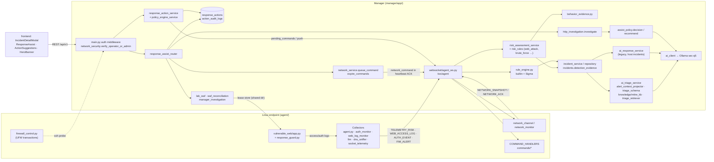

# LARP EDR — Code map

Snapshot of `main` at commit `1481484` plus the P0/P1 changes described in [RESPONSE_ROOT_CAUSE.md](RESPONSE_ROOT_CAUSE.md). Every path below was opened and checked; line numbers are from that snapshot and drift as code changes. Security boundary describes what is enforced at that point, `NONE` meaning nothing is.

## Dependency graph

## Components

### 1. Agent Telemetry Collectors

| Component | File | Class/Function | Input | Output | Called by | Security boundary |
| --- | --- | --- | --- | --- | --- | --- |
| Agent main loop / telemetry orchestrator | `agent/agent.py` | main_agent() L714, send_stats() L527, send_risk_telemetry() L562, execute_command() L513 | MANAGER_URL/AGENT_ID env; WS frames from manager (ack, pending_commands, network_command) | HEARTBEAT, TELEMETRY_RISK, PROCESS_LIST, FLOW_STATS, AUTH_EVENT, COMMAND_ACK WS messages; dispatches commands to COMMAND_HANDLERS | __main__ L760; workers gathered in main_agent L739-745 | Agent identity trusted from env (AGENT_ID=os.getenv/hostname L49). Enrollment token only attached if LARP_NETWORK_AGENT_TOKEN set (network_channel.websocket_auth). TLS only enforced when a network token exists; default MANAGER_URL is wss but plain ws accepted if MANAGER_URL overridden and no token. NONE for message au… |
| Process / suspicious-command collector | `agent/agent.py` | collect_process_info() L214, is_process_suspicious() L175, collect_suspicious_commands() L271, collect_shadow_copy_indicators() L353 | psutil.process_iter over all host processes | process dicts incl pid/exe/cmdline/is_suspicious sent in PROCESS_LIST/TELEMETRY_RISK | send_process_list L624, send_risk_telemetry L562 | NONE (read-only collection; runs as root per larp-agent.service User=root, so reads every process cmdline) |
| Registry/shadow/file-change heuristics | `agent/agent.py` | collect_registry_changes() L310, get_file_changes_count() L298, collect_shadow_copy_indicators() L353 | walks /tmp, reads /etc/hosts, /etc/shadow open_files | synthetic registry_changes/shadow indicators in telemetry | send_risk_telemetry L562 | NONE; fabricates fixed Windows registry value_data strings regardless of real content (L328-331) - telemetry integrity concern, not an auth boundary |
| Auth log monitor | `agent/auth_monitor.py` | AuthMonitor.get_new_events() L93, syslog_timestamp() L17, global_auth_monitor L241 | tails /var/log/auth.log, /var/log/secure, web auth.log, /tmp/auth.log, /tmp/web_auth.log | AUTH_EVENT list (user/ip/status/service) | agent.send_risk_telemetry L581 | Validates username via ACCOUNT regex + strips SQLi indicators (L148); trusts source_ip and client-supplied JSON fields (payload_indicators, session_ref, request_id) from log lines. Lab paths /tmp/auth.log world-writable-ish so any local user can inject auth events. Input validation only on username/session_ref format. |
| Web access log monitor | `agent/web_log_monitor.py` | WebLogMonitor.parse_raw_log_line() L80, tail_cloudflared_logs() L269, _tail_fallback_files() L357 | journalctl -u cloudflared/-u vulnerable_web stream, fallback /tmp/web_access.log etc. | WEB_ACCESS_LOG WS messages | agent web_log_monitor_task L400 -> main_agent L741 | safe_http_target redacts long path segments + extracts SQL indicators; trusts src_ip/Cf-Connecting-Ip/user_agent from log JSON. Spawns journalctl subprocess (fixed argv, no shell). NONE on log-source authenticity. |
| FIM | `agent/fim.py` | FileIntegrityMonitor.check_integrity() L332, calculate_sha256() L296 | SHA-256 of /etc/passwd,/etc/shadow,cron dirs,web upload dirs | FIM_ALERT (CREATED/MODIFIED/DELETED + yara_matches) | agent.send_fim_alerts L672 | NONE (read-only; root reads /etc/shadow). Invokes global_yara_scanner on changed files. |
| DNS sniffer | `agent/dns_sniffer.py` | DnsSniffer.start_background_sniffer() L93, parse_dns_question() L25, global_dns_sniffer L143 | AF_PACKET raw socket (CAP_NET_RAW) UDP/53 packets | recent DNS query buffer -> telemetry dns_queries | agent.send_risk_telemetry L582; started in main_agent L722 | NONE; requires root/CAP_NET_RAW, fails silently otherwise. Bounded parser, no pointer following. |
| Connection tracker | `agent/connection_tracker.py` | ConnectionTracker.process_connections() L216, sample_connections() L191, global_connection_tracker L318 | psutil.net_connections tcp / rows from socket_telemetry | connection_history / active connections in telemetry | socket_telemetry.collect_connections L526; network_monitor L167 | NONE (read-only enrichment) |
| Socket telemetry correlator | `agent/socket_telemetry.py` | collect_connections() L466, socket_holders() L405, _process() L344 | ss output via network_monitor.socket_rows, /proc/<pid>/fd readlinks | attributed connection list (pid/exe/shell/socket_stdio) for TELEMETRY_RISK | agent.get_network_connections L294 | Re-verifies pid create_time/ppid to defend against PID reuse (L360, L444); inode-verified socket attribution. Read-only. Good validation of process identity. |
| Network inventory / snapshot | `agent/network_monitor.py + network_sources.py` | NetworkMonitor.collect() L192, _sockets() L138, run() L28 (network_sources) | ss/ip/ufw/nft/iptables CLI output | NETWORK_SNAPSHOT sections (ports, connections, firewall, nat, routes) | network_channel.NetworkChannel._snapshot L41 | run() uses shell=False, fixed PATH, bounded output/timeout, start_new_session + killpg. No injection surface. NONE for authz (local root). |
| Vulnerable web app (intentionally vulnerable victim) | `agent/vulnerable_web/app.py` | login() L403 (SQLi L422-435), ping() L650 (cmd injection L664-666), upload() L616 (path traversal L630-637), system_check() L684 | HTTP form/query/file from any client on 0.0.0.0:5000 | HTML, telemetry logs, spawned processes | Flask app.run L809 (runs as root per vulnerable-web.service) | login: SQL injection by design (f-string query). ping: shell=True command injection by design. upload: unsanitized filename but saved to fixed /tmp/uploads. system_check: session-auth + role==admin + IP allowlist + 60s cooldown (the only guarded endpoint, L689-726) but spawns no attacker-controlled cmd. secret_key def… |
| Response guard (app-layer enforcement) | `agent/vulnerable_web/response_guard.py` | install_guard.enforce_lease() L33, record_decision() L83 | session audit_nonce, REMOTE_ADDR, leases.db/observations.db (LARP_HTTP_LAB_STATE) | 403/429/401 blocks on /login POST; sqlite receipts | app.install_guard(app) L145 | Only acts for peers in TEST_NETWORKS (RFC5737 ranges L110). Session revocation via sha256(nonce). Read-only lease DB (mode=ro). Rate limit via sqlite rate_window. Disabled unless LARP_HTTP_LAB_STATE set. |
| HTTP evidence helpers | `agent/vulnerable_web/http_evidence.py` | sql_indicators() L124, safe_http_target() L128, SQL_PATTERNS L115 | username / URL strings | bounded SQLi indicator sets, redacted route | auth_monitor, web_log_monitor, app.py | Input validation/sanitization helper: caps at 4096 chars, redacts segments >48 chars, drops control chars. No identity boundary. |

### 2. Manager Ingestion

| Component | File | Class/Function | Input | Output | Called by | Security boundary |
| --- | --- | --- | --- | --- | --- | --- |
| Agent WebSocket endpoint | `manager/app/websocket/agent_ws.py` | agent_websocket_endpoint() L767-885; registered in manager/app/main.py L176 add_api_websocket_route('/ws/agent') | WebSocket at /ws/agent?agent_id=...; header x-larp-agent-token; JSON text frames {type, payload, agent_id, wait_ack} | Dispatches to MESSAGE_HANDLERS (L754-764) or network_service (L828-833) inside a per-message AsyncSessionLocal transaction; sends JSON ack/error; after commit runs AI triage tasks, NotificationService alerts, and dashboard_manager.broadcast (INCIDENT_NEW, ACT… | Python agent (agent/) over the WebSocket; mounted by main.py L176 | Token auth ONLY for agent_ids listed in settings.NETWORK_AGENT_TOKENS (is_enrolled/authenticate_agent, L773-777, close 1008 on bad token). Agent ids that are not enrolled are accepted with no credential. Per-message identity check L805-810: claims must equal the socket agent_id unless agent_id=='unknown'; unauthentica… |
| ConnectionManager singleton | `manager/app/websocket/connection_manager.py` | ConnectionManager L8-60: connect() L25, disconnect() L31, send_personal_message() L37, broadcast() L49; connection_manager L63 | agent_id plus a WebSocket from agent_websocket_endpoint | In-memory maps active_connections and authenticated_connections (agent_id -> socket) | agent_ws.agent_websocket_endpoint (L778-785, L837-839, L882-885); network_router L79 and response_assist_router L177 read authenticated_connections | NONE inside this class. It stores whatever agent_id the caller passes. Only authenticated_connections, which agent_ws fills, marks sockets that are token-verified. |
| Agent token check | `manager/app/core/network_security.py` | token_matches() L10, is_enrolled() L16, authenticate_agent() L20 | agent_id, raw token | bool | agent_websocket_endpoint L773-774; _handle_auth_event L605; _handle_web_access_log L721 | Constant-time SHA-256 digest compare, token length 32-256. Applies only to ids present in NETWORK_AGENT_TOKENS (config.py L38, default empty dict). |
| HEARTBEAT handler | `manager/app/websocket/agent_ws.py` | _handle_heartbeat() L155-177; AgentService.process_heartbeat()/update_heartbeat() agent_service.py L103/L40 | payload validated as HeartbeatDTO (extra=allow) | Upserts the Agent row (auto-registers unknown ids, agent_service.py L50-60), updates AgentActivity heartbeat_at, pulls pending Commands (marks them SENT), returns pending_commands plus network_command if authenticated. Can rebind the socket's agent_id (L836-8… | agent_websocket_endpoint L834-843 | Timestamp window (agent_service L43). Identity comes from the socket-level claim check only. Auto-registration of new agents is NONE. pull_pending_commands blocks unconfirmed or legacy protected commands (command_dispatcher L37-45). |
| PROCESS_LIST handler | `manager/app/websocket/agent_ws.py` | _handle_process_list() L261-286; _save_process_list() L51-151 | payload.processes list, payload.activity_sample, payload.agent_id | Deletes and re-inserts ProcessInfo rows for the agent; record_sample updates AgentActivity; rule_engine.evaluate creates incidents | MESSAGE_HANDLERS L756 | Field truncation and pid range checks (L65-98). The target agent comes from payload.agent_id (L263) with no equality check in this handler; it relies on the endpoint claim check. No cap on list length in _save_process_list. record_sample enforces freshness and ordering. |
| TELEMETRY_RISK handler | `manager/app/websocket/agent_ws.py` | _handle_telemetry_risk() L289-357 | payload: network_connections (max 200 used), process_list, cpu/ram, activity_sample, etc. | Flow rows, rule_engine incidents, RiskAssessmentService.process_risk (RiskScoreRecord, possible incident), ack with score | MESSAGE_HANDLERS L757 | Explicit payload.agent_id == socket agent_id (L292). IP and port validation per connection (L308-313). Max 200 connections (L304). |
| FLOW_STATS handler | `manager/app/websocket/agent_ws.py` | _handle_flow_stats() L360-437 | payload byte/packet deltas, ip_address, flows/connections list | Flow rows (synthetic TCP/UDP plus per-item flows) | MESSAGE_HANDLERS L758 | NONE beyond int() casts. Unbounded flows list, unvalidated src_ip/dst_ip/protocol/pid (L415-431). target_agent_id comes from the payload (L362). |
| FIM_ALERT handler | `manager/app/websocket/agent_ws.py` | _handle_fim_alert() L440-465 | payload file_path/action (whole payload stored) | Event(FIM_ALERT, HIGH, details=raw payload) and rule_engine.evaluate(file_changes) | MESSAGE_HANDLERS L759 | NONE (raw payload persisted with no size or field validation) |
| COMMAND_ACK handler | `manager/app/websocket/agent_ws.py` | _handle_command_ack() L470-587 | CommandAckDTO plus killed_pids/validation/backup_file/quarantine_path/sha256 | Command status, ResponseAction applied or failed, audit log, Incident.detection_evidence.containment and status CONTAINED, Agent isolate/unisolate/quarantine state | MESSAGE_HANDLERS L760 | Command must belong to the socket agent_id and must not be a network action (L475). Kill commands need validation=='validated' and the target pid in killed_pids (L477-482). Protected commands must be in SENT state (L483). ResponseAction must match agent, command and pending status (L498-500). The incident row is locke… |
| AUTH_EVENT handler | `manager/app/websocket/agent_ws.py` | _handle_auth_event() L590-657 | payload.events[] (ssh/flask auth observations) | AuthEvent and Event(AUTH_OBSERVATION) rows deduplicated by stable_id; RiskAssessmentService.process_risk(auth_history_before=now) for events fresher than 5 minutes | MESSAGE_HANDLERS L761 | payload.agent_id must equal the socket id (L592). Agent row locked FOR UPDATE (L595). normalize_auth_event validation (brute_force_rule.py L16-49). session_ref accepted only from enrolled agents (L605). Future timestamps clamped (L617). No cap on the number of events. |
| YARA_SCAN_ALERT handler | `manager/app/websocket/agent_ws.py` | _handle_yara_scan_alert() L659-699 | payload file_path, matched_rules | Event(CRITICAL), a new CRITICAL Incident on every message through IncidentService.create_incident (no dedup), AI triage queued, process_risk(yara_matches) | MESSAGE_HANDLERS L762 | NONE (target_agent_id from the payload L661; no validation of matched_rules or file_path; no dedup or rate limit) |
| WEB_ACCESS_LOG handler | `manager/app/websocket/agent_ws.py` | _handle_web_access_log() L702-751 | normalized HTTP access record (method, path, UA, status, request_id, payload_indicators, src_ip, timestamp) | WebAccessLog row (idempotent by request_id), Event(WEB_ATTACK_DETECTED) per rule_engine.evaluate_web_log match, process_risk(trusted_web=True) | MESSAGE_HANDLERS L763 | payload.agent_id must equal the socket id (L704). http_fields normalization. session_ref only from enrolled agents. trusted_web=True is passed for any socket, including unauthenticated ones (L748). |
| Activity sample recorder | `manager/app/services/agent/activity.py` | record_sample() L33-75; process_identity() L16; socket_key() L24 | agent_id, stream ('process'\|'socket'), payload.activity_sample {version:1, captured_at, complete}, events | AgentActivity.samples[stream] (captured_at, complete, tuples/detections or pid->start_time); session.info['previous_socket_sample']; returns True/False/None | _handle_process_list L265, _handle_telemetry_risk L298 | Freshness window -5 min/+30 s and monotonic ordering per stream (L40-49). Agent row locked, rejected if decommissioned (L42-44). Caps of 8192 processes and 200 sockets. No authentication of its own. |

### 3. Detection/Correlation

| Component | File | Class/Function | Input | Output | Called by | Security boundary |
| --- | --- | --- | --- | --- | --- | --- |
| RiskAssessmentService | `manager/app/services/detection/risk_assessment_service.py` | evaluate() L155-262; process_risk() L285-424; determine_action() L264; apply_category_cap() L103; compute_ema() L66; apply_debounce() L91 | agent_id, telemetry dict/RiskAssessmentDTO, auth_history_before, flow_observations, trusted_web | Weighted rule scores, factors, RiskScoreRecord (raw + EMA smoothed); behavior findings or threshold creates incidents via IncidentService.create_from_risk; dry-run PolicyEngineService; NotificationService alert | _handle_telemetry_risk L343, _handle_auth_event L651, _handle_yara_scan_alert L691, _handle_web_access_log L747 | NONE (trusts its caller). Publishing behavior findings is gated by can_publish (L236-240: brute_force only with auth_history_before, web_attack only with trusted_web). Whitelist suppression uses process names from the client-supplied payload (L365-375). The class-level _rule_hit_counter dict is never cleaned (cleanup_… |
| Risk rule registry | `manager/app/services/detection/risk_rules/__init__.py` | create_default_registry() L25-48; RiskRuleRegistry.sync_from_db_records() registry.py L66-82; RiskRule base.py L5-31 | DetectionRule DB records (enabled/weight/base_score/config) | Registry of 20 RiskRule strategies | RiskAssessmentService.__init__ L149; DetectionRuleService.sync_registry L195 | NONE (DB config applied without bounds checks) |
| WebAttackRule | `manager/app/services/detection/risk_rules/web_attack_rule.py` | inspect_web_log() L14-54; WebAttackRule.evaluate() L68-93; RE_PATH_TRAVERSAL L9 | telemetry.web_logs / web_log / top-level path\|url | Score 75 (sqli_probe_observed with payload_indicators), 60 (sqli tool UA), 55 (automated UA), 90 (path traversal, no behavior evidence); behavior evidence stored in context['behavior_findings']['web_attack'] | RiskAssessmentService.evaluate L219; rule_engine.evaluate_web_log L311-337 | Input normalization via http_fields. payload_indicators asserted by the agent are accepted (behavior_evidence.valid_indicators L48). |
| BruteForceRule / normalize_auth_event | `manager/app/services/detection/risk_rules/brute_force_rule.py` | normalize_auth_event() L16-49; BruteForceRule.evaluate() L140-240 | auth_events list; DB auth history through context['session'] | Score and authentication behavior evidence (password_burst criteria) | RiskAssessmentService.evaluate; _handle_auth_event L601 | Field validation (status enum, count range, TOKEN regex for service/username, IP parse, timestamp_source enum) |
| Behavior evidence normalizer | `manager/app/services/detection/behavior_evidence.py` | http_fields() L76-112; signature_indicators() L42; valid_indicators() L48; stable_id() L52; address() L56; observed_time() L64; technique_for() L115-134 | Raw HTTP/auth dicts from the agent | Sanitized fields: method allowlist, path <=256 chars with long segments redacted, UA <=256 printable, 3-digit status, request_id regex, SQLi indicator names; MITRE technique mapping (T1110/T1046/T1190) | _handle_web_access_log L706, normalize_auth_event, inspect_web_log, rule_engine.evaluate_web_log | Input validation and redaction (query values and bodies are not retained). Paths longer than 256 chars become None, so the record is dropped by the callers. |
| RuleEngine (Sigma + built-in endpoint rules) | `manager/app/services/rule_engine.py` | RuleEngine.evaluate() L207-309; evaluate_web_log() L311-337; _get_active_rules() L340-385; _evaluate_rule() L387-431; _match_field() L465-567; _create_incident… | telemetry + agent_id; active RuleCandidate YAML (60 s cache) | RuleMatch list; new or aggregated Incident rows (fingerprint, detection_evidence, 5-minute sliding dedup window) | agent_ws._evaluate_incident_rules L233-258 (PROCESS_LIST, TELEMETRY_RISK, FIM_ALERT); _handle_web_access_log L741 | NONE (trusts telemetry). Per-agent row lock FOR UPDATE in _create_incidents (L589). SAFE_PROCESSES name-based suppression (L121-152, L232-245, L412-415). Operator regex runs on agent data (L541-546). |

### 4. Incident Persistence

| Component | File | Class/Function | Input | Output | Called by | Security boundary |
| --- | --- | --- | --- | --- | --- | --- |
| IncidentService | `manager/app/services/incident/incident_service.py` | create_incident() L120-145; create_from_risk() L147-285; update_incident() L287-363; get_incident() L582; list_incidents() L590-601; assign/contain/resolve/mar… | IncidentCreate/IncidentUpdate DTOs, risk factors plus behavior evidence, action requests with a client-supplied user string | Incident rows (fingerprint dedup over 5 min of active incidents), IncidentNote, deferred AI triage, notifications, dashboard broadcasts, response actions/commands | routers/v1/incident_router.py (L29-336), RiskAssessmentService.process_risk L394/L407, agent_ws._handle_yara_scan_alert L689, dashboard_service | Lifecycle transition allowlist in update_incident (L295-304). Agent row lock in create_from_risk (L174). kill_process_tree requires verified process identity (L686). Operator confirmation is enforced downstream in ResponseActionService (L73-75). No caller authentication or authorization: the router has no Depends auth… |
| IncidentRepository / active_only filter | `manager/app/repositories/incident_repository.py` | ACTIVE_STATUSES L12; open_incident_filter() L15; network_finding_filter() L19; find_open_incidents() L34; get_active_incidents_for_dashboard() L46; list(active… | skip/limit/active_only/hours/finding | Incident lists. active_only means status in OPEN/INVESTIGATING/CONTAINED and label != false_positive | IncidentService.list_incidents L598; dashboard_service | NONE (parameterized SQLAlchemy; no per-tenant or agent scoping) |
| Incident activity lifecycle | `manager/app/services/agent/activity.py` | incident_activity() L101-171; attach_incident_activity() L174-186; process_observation() L90; observation_expiry() L82 | Incident.detection_evidence (process, network, containment, rule_id), Agent health, AgentActivity samples | Derived fields: detection_activity (active/inactive/stale/unknown/historical), process_activity (running/exited/unknown), last_seen, occurrence_count, disposition | IncidentService.get_incident L587, list_incidents L601, update_incident L362 | NONE (read-only derivation). The derived process_activity=='running' gates kill_process_tree in execute_action L686. |
| Incident HTTP router | `manager/app/routers/v1/incident_router.py` | create_incident L29, list_incidents L37, bulk_resolve L51, bulk_delete L60, delete_incident L69, update_incident L92-96, assign L102, contain/resolve/false-pos… | REST JSON | IncidentService calls | React frontend (frontend/src) | NONE: no auth dependencies, and main.py protect_sensitive_legacy_apis L118-121 exempts the 'incidents' prefix. Actor identity (user, labeled_by, assigned_to) is taken from the request body. |

### 5. AI Evidence Projector

| Component | File | Class/Function | Input | Output | Called by | Security boundary |
| --- | --- | --- | --- | --- | --- | --- |
| AlertContext dataclass | `manager/app/services/ai/alert_context_projector.py` | AlertContext L122-156 (by_id L135, prompt_data() L139) | Projected process/flow/fact dicts, mandatory id set | prompt_data(): dict {alert, processes, flows, facts, missing, omitted{required_evidence}}; puts mandatory ids first, then truncates to the record limit | prepare_prompt() in ai_triage_service.py L93; triage_router, triage_schema, triage_retriever | Shapes the data only. Mandatory evidence is kept ahead of optional evidence, and omitted.required_evidence counts any that would be dropped. String fields are not checked for length or content. NONE for authn/authz |
| build_alert_context | `manager/app/services/ai/alert_context_projector.py` | build_alert_context() L159-477; helpers _value() L43, _inode() L67, _network_key() L74, _verified_attribution() L84, _snapshot() L89, _rule_id() L99 | Incident ORM row (detection_evidence JSON, notes, description, title, risk_score, agent_id), plus optional ProcessInfo rows, Flow rows and a FIM event | AlertContext with processes P1..n, flows N1..n, facts F1..n, missing[], mandatory, verified_shell, conflict, chain_count | load_alert_context() L519; AITriageService._save() L282 (fallback); tests | Input sanitising only. It type-checks scalars (_value), checks protocol and port format, and requires a numeric inode plus an attribution in VERIFIED_ATTRIBUTION for flows. DB rows must share the incident's agent_id and fall within a +/-2 min WINDOW (L184, L199). A flow must link to a known holder identity (L220). A r… |
| load_alert_context | `manager/app/services/ai/alert_context_projector.py` | load_alert_context() L480-521 | AsyncSession, Incident | AlertContext (it queries ProcessInfo up to 48 rows, Flow up to 64 rows and Event FIM_ALERT up to 32 rows, each scoped to incident.agent_id and +/-2 min) | AITriageService._run() L192 | Every query is scoped to incident.agent_id with a time window and a LIMIT. A FIM event is used only if its RuleEngine fingerprint equals incident.fingerprint (L515-517). No authz, because it runs in the background |
| evidence_version | `manager/app/services/ai/alert_context_projector.py` | evidence_version() L108-119 | Incident | SHA-256 over agent_id, fingerprint, snapshot without receipt counters, title, description, notes, risk_score and created_at | AITriageService.analyze_incident L168, _run L191, _save L266 | Integrity check only. If the evidence changes between queueing and persisting, the run is discarded as 'evidence_changed'. NONE for authn |

### 6. Ollama Client

| Component | File | Class/Function | Input | Output | Called by | Security boundary |
| --- | --- | --- | --- | --- | --- | --- |
| TriageInferenceSettings | `manager/app/services/ai/ai_client.py` | TriageInferenceSettings L13-31, TRIAGE_SETTINGS L34 | Env vars AI_TRIAGE_NUM_CTX (4096), AI_TRIAGE_NUM_PREDICT (640), AI_TRIAGE_TEMPERATURE (0.1), AI_TRIAGE_KEEP_ALIVE ('5m'), AI_TRIAGE_STREAM (false), AI_TRIAGE_THINK | request_options() dict {options{num_ctx,num_predict,temperature}, keep_alive, stream, think} | AITriageService._request L254-256; prepare_prompt budget L91 | NONE (configuration only). It bounds the output budget, and the input budget is min(2500, num_ctx-num_predict-8) |
| AIClient.generate | `manager/app/services/ai/ai_client.py` | AIClient.__init__ L38-41, generate() L43-110, _parse_response() L112-145, ai_client singleton L150 | prompt, system, options, format_schema (default 'json' or a Pydantic JSON schema), keep_alive (default '5m'), stream, think, timeout, strict | dict {answer[, reasoning, raw], metrics{done, done_reason, eval counts and durations}} | AITriageService._request L254; AIResponseService.suggest_response L103; assist_policy.recommend L35; validation_service/harvest_service import OLLAMA_URL/DEFAU… | Envelope checks only: rejects non-dict envelopes or an 'error' key (L83-100). Plain HTTP to OLLAMA_URL (default http://ollama:11434) with no auth. Model is DEFAULT_MODEL = env AI_MODEL or 'sec-q5:latest'. Default timeout is httpx.Timeout(600s, connect=10s). Default options are num_ctx 8192, num_predict 2048, temperatu… |

### 7. AI Analysis Validator

| Component | File | Class/Function | Input | Output | Called by | Security boundary |
| --- | --- | --- | --- | --- | --- | --- |
| Token counter / serializer | `manager/app/services/ai/triage_tokens.py` | TriageTokenizer L24-63 (count_text L49, clip_text L52, count_chat L58), load_tokenizer() L66-68, serialize_data() L71-76 | GGUF file (AI_TRIAGE_GGUF, or models/Foundation-Sec-8B-Reasoning.Q5_K_M.gguf, or /models/...); text; dict/list payload | Token counts built with the model's own chat template; clipped text; compact JSON with <>\|& and bidi/line-separator characters escaped as \uXXXX | prepare_prompt(); retrieve_references() L349; AIResponseService._build_prompt L400 | Prompt hardening: escapes template delimiters and bidi controls so DATA cannot break out of the chat template, and renders the chat template in an ImmutableSandboxedEnvironment. Validates tokenizer metadata (gpt2/llama-bpe). It does not stop natural-language prompt injection |
| Triage router + admission queue | `manager/app/services/ai/triage_router.py` | route_triage() L30-53, RoutingDecision L20-27 (deadline 120s / 180s for multi-phase), TriageQueue L56-87 (submit L67, capacity = max_waiting+1), triage_queue L… | AlertContext, manual flag, env AI_TRIAGE_ENABLE_SKIP | Route SKIP_LLM / SINGLE_PASS / MULTI_PHASE, plus shadow_candidate; queued asyncio.Task, or None when saturated | AITriageService.analyze_incident L169, _run L197 | Process-wide admission control: one Ollama slot through Semaphore(1), at most 9 pending jobs, deduplicated by (incident_id, evidence_version). Not a per-client rate limit. Skip-LLM is opt-in and needs a verified inode shell or a low risk_score (<35) with an inode-verified ESTABLISHED flow. risk_score can be edited by … |
| Output schema and verdict validator | `manager/app/services/ai/triage_schema.py` | TriageVerdict L46-49, EvidenceAssessment L31-39, TechniqueClaim L42-43, parse_output() L68-82, permitted_techniques() L85-97, behavior_verdict() L100-124, vali… | Ollama result dict (answer, metrics), schema class, visible evidence ids, AlertContext | ValidatedVerdict(classification, confidence, evidence_ids, techniques, evidence_completeness), or VerdictSchemaError | AITriageService._request L259, _infer L245, fallback_verdict L147-154 | Strong output validation. It rejects done=false, done_reason=length and answers over 16KB, and rejects duplicate JSON keys. Pydantic runs with extra='forbid' and strict=True. Evidence ids must match ^[PNF][1-9]\d{0,2}$, with at most 8 and all unique. Ids must belong to the visible prompt set. MITRE ids must match ^T\d… |
| MITRE knowledge base | `manager/app/services/ai/knowledge/mitre_kb.py` | MITREKnowledgeBase L11-48 (load L19, validate_technique L32, get_technique L39), mitre_kb L51 | knowledge/mitre_techniques.json (local file) | Technique existence check and {name, tactic} metadata | triage_schema.validate_verdict/behavior_verdict/format_technique; triage_retriever._validated_ids/retrieve_references | Allowlist of technique ids, normalised with strip().upper(). If the file is missing or fails to parse, the KB is empty and every technique is rejected (fail closed) |
| Rule mapping / reference retriever | `manager/app/services/ai/knowledge/triage_retriever.py` | SOPS L15-30, RISK_TECHNIQUES L31, _validated_ids() L34-38, enrich_rule_mapping() L52-83, retrieve_references() L86-106 | AsyncSession, AlertContext (rule_id/rule_version from the projector), RuleCandidate/RuleVersion YAML tags | context.mapped_techniques (at most 8, KB-validated); up to 2 reference docs under 400 tokens (larp_sop excerpt, mitre_kb entries) | AITriageService._run L193, _infer L234 | Rule tags are used only when the rule_version hash matches the current YAML or one of the last 20 RuleVersion rows. Uses yaml.safe_load. Ids must exist in the KB. References are capped at 400 tokens. The rule_id it uses can come from incident.notes (see findings) |
| AITriageService orchestration | `manager/app/services/ai/ai_triage_service.py` | SYSTEM_PROMPT L38-47, ASSESSMENT_PROMPT L48, prepare_prompt() L87-143, fallback_verdict() L146-157, AITriageService.analyze_incident() L161-176, _run() L178-22… | incident_id, manual flag | Persisted AIAnalysis row (analysis_type='triage', summary markdown, confidence, mitre_techniques, model_name, raw_response JSON with status/evidence_version/evidence_summary) | incident_router.regenerate_ai_analysis L192/L207 (HTTP, manual=True); agent_ws._run_ai_triage L180/L206; incident_service._safe_trigger_ai_triage L73/L101 (run… | Within the service: input token budget of 2500, queue wait 20s, deadline 120s (180s multi-phase) with 5s reserved for the DB write. On timeout, schema error, budget overflow or model error it falls back to a deterministic verdict. It re-checks evidence_version under SELECT FOR UPDATE before persisting. The system prom… |

### 7b. Legacy AI response suggestion (host incidents only)

| Component | File | Class/Function | Input | Output | Called by | Security boundary |
| --- | --- | --- | --- | --- | --- | --- |
| suggest_response | `manager/app/services/ai/ai_response_service.py` | AIResponseService.suggest_response() L42-178; _system_prompt() L364; _build_prompt() L376-400; _parse_json_answer() L402-441; _validate_suggestion() L443-538; … | incident_id. Reads the latest triage AIAnalysis, the incident, 100 ProcessInfo rows, 20 Flow rows and 3 'true_positive' historical incidents | Updates the latest triage AIAnalysis: suggested_action, suggestion_params, suggestion_reasoning, blast_radius. Clears applied_by_analyst and dismissed_by_analyst | incident_router.suggest_ai_response L264/L278 (BackgroundTask) | Partial output validation. Action must be in ALLOWED_ACTIONS (L25-32). Confidence must be >=0.6, which NaN slips past. PID must exist in the agent's ProcessInfo and pass check_agent_kill_protection. block_ip needs the IP in recent flows (src or dst). Calls ai_client.generate with default settings (num_ctx 8192, num_pr… |
| apply_suggestion | `manager/app/services/ai/ai_response_service.py` | AIResponseService.apply_suggestion() L180-329 | incident_id, analyst (string from the client), session, confirmed flag | ResponseAction created through ResponseActionService.create_and_apply_action (kill_process / kill_process_tree / suspend_process / isolate / block_ip). Records applied_by_analyst and a feedback_signal | incident_router.apply_ai_suggestion L294/L304 | Idempotency: refuses if already applied or dismissed. PID must be in ProcessInfo and pass agent self-protection. Kill requires detection_evidence.process.pid to equal the suggested pid (L297-302). block_ip needs the dst_ip in flows from the last hour. Downstream, create_and_apply_action requires confirmed=True for CON… |
| dismiss_suggestion | `manager/app/services/ai/ai_response_service.py` | AIResponseService.dismiss_suggestion() L331-358 | incident_id, analyst (string from the client), reason | Sets dismissed_by_analyst, dismissed_at and dismiss_reason on the latest triage AIAnalysis | incident_router.dismiss_ai_suggestion L327/L338 | NONE (no auth, identity taken from the client, no length limit on reason) |

### 8. Response Recommendation

| Component | File | Class/Function | Input | Output | Called by | Security boundary |
| --- | --- | --- | --- | --- | --- | --- |
| HTTP investigation / proposal builder | `manager/app/services/response/http_investigation.py` | investigate() L116, http_behavior() L110, match_proposal() L102, related_records() L261, CollectionProposal L32 / BlockProposal L57 / RateProposal L67 / Revoke… | Incident ORM row (detection_evidence.behavior with source_event_ids/evidence_id), WebAccessLog, AuthEvent+Event rows for incident.agent_id, lab_waf sqlite observations | (investigation dict with observed_facts, classification, confidence, recommended_responses[], proposal) - frozen pydantic proposals with sha256 action_id derived from evidence fingerprint; related_records returns +/-2 min records (http, auth, flows, process, … | response_assist_router.proposals/propose/transition; response_action_service.create_and_apply_action (http_behavior guard) | Input validation only: evidence ids len<=64, count<=64, all rows must belong to incident.agent_id (L120-128); targets are server-derived; WAF proposals only if lab_waf.direct_observation confirms non-forwarded direct peer (L222, L236). No authn (caller enforces). |
| Assist policy (AI selection gate) | `manager/app/services/response/assist_policy.py` | ModelChoice L15, decision() L21, recommend() L29 | investigation dict + selected proposal | decision(): REQUIRE_MORE_EVIDENCE / DENY / ALLOW_AUTOMATIC (guidance only) / REQUIRE_APPROVAL; recommend(): (selected bool, source 'ollama'\|'policy_fallback', latency_ms) | response_assist_router.proposals/propose/transition | LLM output constrained: strict JSON schema, evidence IDs must equal proposal evidence exactly, action must be candidate or no_action; 12s timeout; failure -> deterministic fallback. No authn. |
| AI Response Assist router | `manager/app/routers/v1/response_assist_router.py` | operator() L34, scoped_incident() L41, view() L51, GET proposals() L56-57, POST propose() L72-73, scoped_action() L119, GET detail() L128-129, POST transition(… | HTTP: Authorization Bearer header, incident_id / action_id path, body ProposalRequest{action_type?} or EmptyRequest (extra=forbid) | JSON investigation + policy_decision + actions; creates ResponseAction rows (ASSIST_TYPES), ActionAuditLog events, IncidentNote, Command(network_refresh), lab WAF leases | Frontend ResponseAssist component via /api/v1/incidents/{id}/response-proposals and /api/v1/response-actions/{id}[/{op}] | verify_operator_or_admin bearer token; anonymous_dev rejected (L36-37); agent scope check against incident.agent_id / action.agent_id; write=True (admin role) for transitions (L142); propose only needs read role (L76). Re-validates evidence before approve/execute (L163-168); optimistic status claim (L169-172); Collect… |

### 9. Response Policy

| Component | File | Class/Function | Input | Output | Called by | Security boundary |
| --- | --- | --- | --- | --- | --- | --- |
| Policy engine / graduated response | `manager/app/services/response/policy_engine_service.py` | POLICY_LEVELS L28, get_action_for_score() L39, PolicyEngineService.evaluate_and_execute() L202, _dispatch_action() L123, _create_alert_only() L397, _execute() … | agent_id, risk_score, context dict (may contain pid/process_name/incident_id), dry_run flag, incident_id | PolicyEvaluateResponse; when dry_run=False and setting auto_response_enabled true -> ResponseActionService.create_and_apply_action (single agent) or AgentGroupService.execute_group_action (group scope) | response_policy_router.evaluate_policy (dry_run from client); risk_assessment_service L413 (dry_run=True) | Global auto_response_enabled gate (L137-162); agent self-protection for kill (L173-186); downstream CONFIRMATION_REQUIRED rejects actor policy_engine. No authn/authz itself. |
| Response policy CRUD + matching | `manager/app/services/response/response_policy_service.py` | ResponsePolicyService.create_policy() L33, update_policy() L80, delete_policy() L143, match_policy() L153 | policy fields (name, score range, free-form action_type string, scope, target_group_id, action_params dict, auto_rollback_seconds, priority) | ResponsePolicy rows; highest-priority matching policy | response_policy_router; PolicyEngineService | Validation only: min<=max, scope in {agent,group}, target group exists. action_type and action_params unvalidated. |
| Response policy repository | `manager/app/repositories/response_policy_repository.py` | list_all_ordered() L14, get_by_id_with_group() L23, find_matching_policies() L32 | score, agent group ids | ordered ResponsePolicy list (active, range match, target_group null or in agent groups) | ResponsePolicyService | NONE |
| Response policy router | `manager/app/routers/v1/response_policy_router.py` | list_policies() L26, create_policy() L43, get_policy() L69, update_policy() L85, delete_policy() L113, evaluate_policy() L128 | HTTP JSON ResponsePolicyCreate/Update, PolicyEvaluateRequest{agent_id, risk_score, dry_run, context} | policy DTOs, PolicyEvaluateResponse (may execute live actions) | Frontend / any HTTP client at /api/v1/policies* | NONE (no Authorization dependency; main.py protect_sensitive_legacy_apis only guards /api/v1/actions*, kill paths and /commands) |

### 10. ResponseAction / ActionAuditLog

| Component | File | Class/Function | Input | Output | Called by | Security boundary |
| --- | --- | --- | --- | --- | --- | --- |
| ResponseAction model | `manager/app/models/response_action.py` | ResponseAction L10 | - | table response_actions (id, incident_id FK SET NULL, agent_id FK CASCADE, action_type, action_params JSON, status, snapshot JSON, auto_rollback_at, cooldown_until, outcome, feedback_signal) | all response services/routers | NONE |
| ActionAuditLog model | `manager/app/models/action_audit_log.py` | ActionAuditLog L9 | - | table action_audit_logs (action_id NOT NULL FK CASCADE, event, actor, reason, metadata) | ActionAuditLogRepository | NONE (audit rows cascade-deleted with action; not append-only) |
| ResponseAction repository | `manager/app/repositories/response_action_repository.py` | get_for_update() L14, list_all() L24, get_by_agent() L43, get_by_incident() L54, get_active_applied_by_incident() L63, get_active_applied_by_agent() L75, get_a… | filters | ResponseAction lists (list/get_by_* exclude ASSIST_TYPES) | ResponseActionService, RollbackService, scheduler.periodic_auto_rollback | NONE (row lock in get_for_update) |
| ActionAuditLog repository + service | `manager/app/services/common/audit_log_service.py` | ActionAuditLogService.record_event() L19, get_logs_for_action() L38; ActionAuditLogRepository.create_log() L13, get_by_action() L35 (manager/app/repositories/a… | action_id, event, actor string, reason, metadata | flushed ActionAuditLog row; ordered log list | response_action_service, rollback_service, policy_engine, waf_reconciliation, manager_investigation, network_service, response_assist_router, agent_ws | NONE (actor is caller-supplied string) |
| ResponseActionService | `manager/app/services/response/response_action_service.py` | create_and_apply_action() L50, get_action() L212, list_actions_by_agent() L217, list_actions_by_incident() L220, list_all_actions() L223 | agent_id, action_type, action_params (client dict), incident_id, actor, auto_rollback_seconds | ResponseAction(status=pending)+snapshot, audit 'created', Command(action, payload=action_params+action_id) pushed via command_dispatcher | response_action_router.create_and_apply_action, PolicyEngineService._dispatch_action, AgentGroupService.execute_group_action | Validation: blocks HTTP incidents (L62-67), network_* reserved (L68), raw kill (L71), CONFIRMATION_REQUIRED needs confirmed=True and non-system actor (L73-75), kill target pid/start/exe/ppid + agent self-protection (L83-101), cooldown (L106-116). No authn. |
| Response action router | `manager/app/routers/v1/response_action_router.py` | _enforce_operator() L28, create_and_apply_action() L43, list_all_actions() L62-64, get_response_action() L83, undo_single_action() L96, get_action_audit_logs()… | HTTP JSON ResponseActionCreate (enum action_type), Undo requests, query filters | ResponseAction DTOs incl. action_params & snapshot, audit logs, UndoBatchResponse, auto-rollback settings | Frontend /api/v1/actions, /api/v1/agents/{id}/actions, /api/v1/incidents/{id}/actions, /api/v1/settings/auto-rollback | Mutating endpoints: _enforce_operator write=True + agent scope (create, undo, undo-all). /api/v1/actions* also gated by main.py middleware (write, no agent scope). GET /agents/{id}/actions, GET /incidents/{id}/actions, GET /settings/auto-rollback: NONE. |

### 11. Agent Command Transport

| Component | File | Class/Function | Input | Output | Called by | Security boundary |
| --- | --- | --- | --- | --- | --- | --- |
| Command receive/dispatch/ACK | `agent/agent.py` | execute_command() L513, send_stats() L540-554 | pending_commands list from HEARTBEAT ack: {action, payload, command_id} | COMMAND_ACK with status/validation/killed_pids | send_stats loop L542 | Agent-side confirmation gate: isolate/auto_isolate/quarantine/block_ip/remove_registry/suspend_process require payload.confirmed is True (L516). kill_process[_tree]_verified suffix stripped L518. Otherwise executes ANY action in COMMAND_HANDLERS with no signature/authorization - fully trusts manager channel. No per-co… |
| Command registry | `agent/commands/__init__.py` | COMMAND_HANDLERS L10 | action name string | handler instance | agent.execute_command L520 | NONE; static dispatch table. Any registered action name reachable. |
| Process kill (pidfd-verified) | `agent/commands/process_target.py` | terminate() L29, _protected() L16, _identity() L25 | params pid/process_start_time/exe_path/parent_pid/confirmed | killed_pids, validation status | kill_process.py L8, kill_process_tree.py L8 | Strong: requires confirmed is True (L35), full type/identity validation (L37-40), PROTECTED process set + agent-lineage + pid<=2 guards (L16-22), pidfd re-verification against create_time/exe/ppid before SIGTERM (L68,L77). Best-guarded command. Arbitrary PID kill possible but protected set excludes critical daemons. |
| SYN flood | `agent/commands/syn_flood.py` | SynFloodCommand.execute() L8 | payload target_ip, target_port, duration | runs hping3 flood via subprocess | agent.execute_command / manager attack_service | NONE. No confirmed check (not in CONFIRMATION set). target_ip passed to subprocess.run argv (list, no shell) but agent will DoS ANY target the manager names. Arbitrary outbound attack primitive, root. |
| Scoped isolation / unisolate | `agent/commands/isolate.py + scoped_isolation.py` | IsolateCommand.execute() L13, scoped_isolation() L24, take_containment_priority() | payload confirmed; MANAGER_URL; ws peer addr | nft table larp_containment drop-all except manager/DNS/lo | agent.execute_command (isolate/unisolate/auto_isolate) | confirmed gate at agent.execute_command L516. Holds firewall_lock, resolves manager addrs, preserves host firewall. Rejects if legacy /tmp/isolated present. Root nft execution. |
| YARA scan | `agent/commands/yara_scan.py` | YaraScanCommand.execute() L10 | payload target_path, recursive, rules_source | yara matches | agent.execute_command; manager yara_service dispatches rules_source | NONE. Manager-supplied rules_source compiled via yara.compile (yara_scanner.load_rules L39) and target_path arbitrary - manager can direct agent to scan/read any path and load arbitrary YARA rules. No confirmed check. |
| Self-update (stub) | `agent/commands/self_update.py` | SelfUpdateCommand.execute() L11 | payload download_url, version | logs intent, returns success (no actual download) | agent.execute_command; manager agent_router L125 | NONE but currently inert (does not fetch/execute). If implemented, download_url is unauthenticated manager-controlled code path. |
| Quarantine / release (stub) | `agent/commands/quarantine.py` | QuarantineCommand L5, ReleaseQuarantineCommand L13 | payload reason | success message only | agent.execute_command | confirmed gate for quarantine at L516; no-op handlers. |
| Network command channel (firewall) | `agent/network_channel.py` | NetworkChannel._handle() L81, _execute() L61, _snapshot() L41, run() L117 | network_command dict from HEARTBEAT ack: command_id(32-hex), agent_id, schema_version, expires_at, params | NETWORK_SNAPSHOT, NETWORK_ACK, NETWORK_TRANSACTION | agent.send_stats L539 via NETWORK.deliver; main_agent L744 | Strong validation: command_id must be 32 lowercase hex (L83), agent_id must match self + schema_version==1 (L85), replay cache 240s (L87-90), expires_at window 0-60s future (L94), firewall_safety_version must equal SAFETY_VERSION (L66). Only enabled if LARP_NETWORK_AGENT_TOKEN set (NETWORK None otherwise). |
| Firewall control (UFW transactions) | `agent/firewall_control.py` | request() L529, _apply() L595, _command() L410, approve() L786, _profile() L144 | params operation/action/protocol/port/source/reason/confirmed/transaction_id | UFW rule changes with 60s auto-rollback timer | network_channel._execute L71; systemd apply/rollback services | Extensive: confirmed required (L530), reason 1-255 chars, HEX_ID command id, operation whitelist (L417), port range + protects 53/ssh_port (L454), interface/source validated, SSH port protected from deletion (L450), static config SHA256 pinned (L147,L612), live SSH approval (L386), kernel/file fingerprint verification… |
| Firewall management discovery | `agent/firewall_management.py` | manager_url() L158, discover_ssh_port() L175, validate_anchors() L213 | MANAGER_URL, ss/systemctl output, UFW before.rules | validated ssh_port, anchor-rule checks | firewall_control._profile/_apply | Requires wss Manager URL w/o username (L160); exactly one non-loopback SSH port; read-only discovery. |
| Bounded command runner | `agent/network_sources.py` | run() L28, run_json() L76 | tool name + argv, optional stdin | stdout string | all firewall/network collectors | shell=False, fixed SEARCH_PATH, env scrubbed, output/time bounded, start_new_session + killpg on timeout. No shell injection. This is the safe exec primitive. |
| Agent WS endpoint (manager) | `manager/app/websocket/agent_ws.py` | agent_websocket_endpoint() L766, _handle_heartbeat() L160, pull_pending_commands dispatch L168 | client agent_id query param, x-larp-agent-token header, JSON frames | pending_commands, network_command | FastAPI WS route | is_enrolled(agent_id) only true if agent_id in NETWORK_AGENT_TOKENS (network_security L16); if NOT enrolled, connection accepted with NO token and client-supplied agent_id trusted (L773-776 only closes when enrolled&&!authenticated). network_command gated on authenticated (L839); but telemetry ingestion + non-protecte… |
| Command dispatcher (manager) | `manager/app/services/core/command_dispatcher.py` | pull_pending_commands() L32 | queued Command rows | commands sent to agent | agent_ws heartbeat L168 | Blocks PROTECTED_COMMANDS (kill/isolate/quarantine/block_ip...) unless payload.confirmed is True AND action_id present (L40-44). syn_flood, yara_scan, self_update are NOT in PROTECTED set -> dispatched with no confirmation/authz. |
| Attack router (manager) | `manager/app/routers/v1/attack_router.py` | launch_syn_flood() L10 | AttackRequestDTO (target) | queues syn_flood Command | POST /api/v1/attack/syn-flood | NONE. Only db dependency. Not in main.py protect_sensitive_legacy_apis exempt/action list (L117-134) so even with auth configured this mutating endpoint is unauthenticated -> anyone can command agents to SYN-flood arbitrary targets. |

### 12. Flask/WAF Response Adapter

| Component | File | Class/Function | Input | Output | Called by | Security boundary |
| --- | --- | --- | --- | --- | --- | --- |
| LabWaf config model + HTTP_RESPONSE_LAB_WAFS | `manager/app/core/config.py` | LabWaf L21-24; Settings.HTTP_RESPONSE_LAB_WAFS L40; distinct_network_tokens() L49-60 | .env / environment: dict agent_id -> {directory, disposable_peers, protected_peers} | settings.HTTP_RESPONSE_LAB_WAFS consumed by lab_waf.py | lab_waf.eligible/store at import-time settings singleton | Validator only enforces that resolved directories are distinct per agent (L51-53). No check that directory is absolute/exists at load (deferred to store()), no IP-format validation of peers (strings). |
| lab_waf.eligible (target eligibility) | `manager/app/services/response/lab_waf.py` | NETWORKS L12; eligible() L16-23 | agent_id, peer IP string | bool | direct_observation L37, activate L49, credential_mismatch L81 | Target allow-list: peer must be in config.disposable_peers, not in protected_peers, and inside RFC5737 TEST-NET ranges excluding network/broadcast address. No auth (internal). |
| lab_waf.store (shared SQLite store opener) | `manager/app/services/response/lab_waf.py` | store() L26-33 | agent_id, db name (observations.db\|leases.db), sqlite mode (ro\|rw\|rwc) | sqlite3 connection (URI mode, timeout 0.4s) | all lab_waf functions | Requires agent to be configured and directory absolute+existing (409 otherwise). Store is shared purely via the local filesystem directory: manager writes leases.db, Flask lab writes observations.db in the same directory (Flask side = env LARP_HTTP_LAB_STATE). No docker-compose mount configures this; requires co-locat… |
| lab_waf evidence readers | `manager/app/services/response/lab_waf.py` | direct_observation() L36-45; credential_mismatch() L80-89; revocation_receipt() L100-102 | agent, peer, request_id, session_ref, observed_at | bool / receipt row (read-only from observations.db) | http_investigation.investigate (L177, L222, L236 of http_investigation.py), waf_reconciliation.reconcile L39 | Eligibility check + forwarded=0 + TTL 300s + \|at-observed_at\|<=5s. Trusts rows written by the Flask app process (no signature). |
| lab_waf lease writers/verifier | `manager/app/services/response/lab_waf.py` | activate() L48-57; verify() L60-70; rollback() L73-77; revoke() L92-97 | agent, peer, action_id(key), deadline, kind / session_ref | lease row in leases.db (lease, revoked_session tables); verify returns (status, evidence_refs) | waf_reconciliation.reconcile L37,L44,L50,L52 | kind allow-list {temporary_ip_block, apply_rate_limit}; eligibility; deadline in future; single-owner lease via ON CONFLICT ... WHERE expired OR same action_id (L53-57); rollback deletes only own action_id. No caller auth (relies on router). |
| WAF reconciliation | `manager/app/services/response/waf_reconciliation.py` | reconcile() L16-91 | DB session, ResponseAction row (WAF_TYPES), optional undo_actor | Updated row.status/snapshot.verification + audit events | response_assist_router proposals() L66, detail() L132, transition() L148/L194 | Optimistic status-claim UPDATE (L20-25) to serialize; no auth itself (callers enforce operator scope). Status 'succeeded' derived from receipts in Flask-written observations.db. |
| Flask response_guard (enforcement point) | `agent/vulnerable_web/response_guard.py` | install_guard() L11-107; enforce_lease() L34-81; record_decision() L84-107; TEST_NETWORKS L110 | Flask request (session audit_nonce cookie, REMOTE_ADDR, path/method), leases.db (ro), env LARP_HTTP_LAB_STATE | 401 (revoked session), 403 (temporary_ip_block), 429 (rate limit >3/10s), observation/grant_observation/revocation_receipt rows in observations.db | agent/vulnerable_web/app.py install_guard(app) L145 (after assign_observation_id L141); login() L403 sets session audit_nonce/g.session_ref L443-444 | Only active if LARP_HTTP_LAB_STATE set; only POST /login from direct REMOTE_ADDR in TEST-NETs is enforced; revocation check fails closed (503, L46-48) but lease lookup fails OPEN (L62-64); forwarded headers recorded as flag only. |

### 13. Verification / Rollback

| Component | File | Class/Function | Input | Output | Called by | Security boundary |
| --- | --- | --- | --- | --- | --- | --- |
| RollbackService | `manager/app/services/response/rollback_service.py` | rollback_action() L47, rollback_incident_actions() L193, rollback_agent_actions() L225, rollback_group_actions() L257 | action_id/incident_id/agent_id/group_id, reason, actor | compensation Command (unisolate/restore_file/restore_registry via SnapshotService.get_compensation_action), Agent DB state restored, status reverted, cooldown, audit events | response_action_router undo endpoints, agent_group_router.undo_all_group_actions L210, scheduler.periodic_auto_rollback (actor=system) | Row lock + status=='applied' check + UNROLLBACKABLE_ACTIONS (L60-80). No authz itself. |
| Lab WAF adapter | `manager/app/services/response/lab_waf.py` | eligible() L16, store() L26, direct_observation() L36, activate() L48, verify() L60, rollback() L73, credential_mismatch() L80, revoke() L92, revocation_receip… | agent id, peer IP, request_id, action id, deadline, kind; per-agent sqlite dirs from settings.HTTP_RESPONSE_LAB_WAFS | lease / revoked_session rows in leases.db; receipt checks from observations.db | http_investigation.investigate, waf_reconciliation.reconcile | Target safety: peer must be in configured disposable_peers, not protected_peers, and within TEST-NET ranges (L16-23); lease ownership conflict check (L53-57); parameterized SQL; absolute configured directory. |
| WAF reconciliation / verification | `manager/app/services/response/waf_reconciliation.py` | reconcile() L16 | ResponseAction (temporary_ip_block/apply_rate_limit/revoke_session) in dispatched/verifying/succeeded/rollback_failed/partial; optional undo_actor | lab lease activation/verification/rollback, status transitions, snapshot.verification record, audit events | response_assist_router (GET proposals, GET detail, POST transition), assist_worker.reconcile_pending | Optimistic status claim update (L20-25); relies on lab_waf eligibility; no authn. |
| Manager investigation (guidance + watch) | `manager/app/services/response/manager_investigation.py` | record_guidance() L13, reconcile_watch() L42 | ResponseAction (generate_remediation_guidance / increase_monitoring), actor | IncidentNote persisted & verified; time-bounded WebAccessLog query results, status monitoring/expired/rolled_back, audit | response_assist_router.transition/proposals/detail, assist_worker.reconcile_pending | NONE (agent_id-scoped queries; status claim) |
| Assist worker (restart reconciliation) | `manager/app/services/response/assist_worker.py` | reconcile_pending() L12 | non-terminal ASSIST_TYPES ResponseActions (keyset paginated, 50/batch) | expire_commands for COLLECT, reconcile/reconcile_watch for others | scheduler.start_background_tasks every 10s (L147-148) | NONE (internal) |
| Background scheduler | `manager/app/services/core/scheduler.py` | Scheduler.schedule_task() L20, start_background_tasks() L49, periodic_auto_rollback() L113 | timers; auto_rollback settings; expired applied actions | RollbackService.rollback_action(actor='system') every 5s; reconcile_pending every 10s | main.py lifespan L71 | NONE (internal) |
| Network command queue / expiry | `manager/app/services/agent/network_service.py` | queue_command() L163, expire_commands() L145, _collection_state() L110, _update_action() L92, pull_network_command() L226, acknowledge() L249, record_transacti… | agent_id, operator identity, optional firewall operation; agent ACK payloads | Command(network_refresh\|network_firewall) with 45s TTL; ResponseAction state for firewall & collect actions; verification record requiring correlated snapshot | response_assist_router.transition (COLLECT), network_router, assist_worker, agent ACK handlers | Per-agent row lock, 5s throttle (L203-208 -> 429), single pending command, isolated-agent and fresh Linux snapshot + safety_version checks for firewall, ACK identity/command ownership match, snapshot correlation required for success. AuthN done by callers. |

### 14. Dashboard

| Component | File | Class/Function | Input | Output | Called by | Security boundary |
| --- | --- | --- | --- | --- | --- | --- |
| Axios API client | `frontend/src/api/api.js` | api axios.create L7; request interceptor L16-29; response interceptor L32-41 | Token from sessionStorage/localStorage 'larp_network_token' or localStorage 'token' | HTTP requests to VITE_API_BASE_URL or /api/v1 with Authorization: Bearer <token>; unwraps res.data; normalizes errors to Error(message) | all frontend/src/api/*.js and ResponseAssist.jsx | Client-side only: attaches bearer token if present; no login flow; token stored in Web Storage (XSS-readable). |
| Incidents API module | `frontend/src/api/incidents.js` | mapIncident L4; executeIncidentAction L172; updateIncidentStatus L141; addIncidentNote L132; assignIncident L162; closeIncident L185; getAIAnalysis..dismissAIS… | incidentId, action type, params, hard-coded user ('admin'/'current_user') | REST calls: POST /incidents/{id}/action, /contain\|/resolve\|/false-positive\|/close, PATCH /incidents/{id}, POST /notes, /assign, /ai-analysis/* | IncidentDetailModal, AIAnalysisTab, AISuggestionPanel | NONE (sends client-chosen identity strings such as user='admin', analyst='current_user' that server stores as actor). |
| IncidentDetailModal | `frontend/src/components/incidents/IncidentDetailModal.jsx` | IncidentDetailModal L42; handleAction L79-108; handleStatusChange L110; handleConfirmClose L138; tabs render HeroBanner L199, ResponseAssist L248, ActionSugges… | incident prop; user clicks | executeIncidentAction / updateIncidentStatus / closeIncident calls; renders child tabs | Incidents page | UI window.confirm for kill_process_tree/isolate/block_ip and adds confirmed:true (L81-85) - client-side only; NONE server-side. |
| ResponseAssist panel | `frontend/src/components/incidents/ResponseAssist.jsx` | ResponseAssist L6; load L16; handleOperation L49-97 | incidentId | GET/POST /incidents/{id}/response-proposals; GET /response-actions/{id}; POST /response-actions/{id}/{approve\|reject\|execute\|rollback}; polls every 3s while active | IncidentDetailModal tab 'assist' | window.confirm before mutating ops (client-only); relies on server bearer auth (response_assist_router). |
| AIAnalysisTab | `frontend/src/components/incidents/AIAnalysisTab.jsx` | AIAnalysisTab L7; handleRegenerate L45; handleRate L109; renders AISuggestionPanel only if !httpIncident L466 | incidentId, httpIncident flag (detection_evidence.behavior.evidence_type==='http') | GET /ai-analysis, POST /ai-analysis/regenerate, /rate | IncidentDetailModal L257 | NONE (UI hides suggestion panel for HTTP incidents; server also rejects in ai_response_service via http_behavior()). |
| AISuggestionPanel | `frontend/src/components/incidents/AISuggestionPanel.jsx` | AISuggestionPanel L81; handleTriggerSuggest L120; handleApply L163-179; handleConfirmDismiss L181 | incidentId | POST /ai-analysis/suggest-response, /apply-suggestion {analyst:'analyst_soc', confirmed:true}, /dismiss-suggestion | AIAnalysisTab, ActionSuggestions | window.confirm only; hard-codes analyst identity client-side. |
| ActionSuggestions | `frontend/src/components/incidents/ActionSuggestions.jsx` | ActionSuggestions L19; onAction(sug.actionType, sug.params) L127 | incident, onAction callback | Invokes IncidentDetailModal.handleAction; embeds AISuggestionPanel | IncidentDetailModal tab 'actions' | NONE |
| HeroBanner | `frontend/src/components/incidents/HeroBanner.jsx` | HeroBanner L21; onAction('unisolate') L209, ('isolate') L219, ('kill_process_tree',{pid}) L231 | incident, isIsolated | Quick action callbacks to handleAction | IncidentDetailModal L199 | NONE |

### 15. Authentication / RBAC

| Component | File | Class/Function | Input | Output | Called by | Security boundary |
| --- | --- | --- | --- | --- | --- | --- |
| Token verification core | `manager/app/core/network_security.py` | token_matches() L10-13; is_enrolled() L16; authenticate_agent() L20; authorize_agent() L24; verify_operator_or_admin() L28-73; require_network_read() L76; requ… | Authorization header 'Bearer <token>', optional agent_id, write flag; X-LARP-Agent-Token for agents | (identity, NetworkOperator\|None) or HTTPException 401/403 | main.protect_sensitive_legacy_apis, network_router, process_router._enforce_operator, response_action_router._enforce_operator, response_assist_router.operator | SHA-256 digest + compare_digest, token length 32-256. Legacy admin token: superuser, bypasses agent scope (L56-57). Operators: agent scoping only if config.agents non-empty (L63), write requires role admin (L65). If no operators/legacy configured -> returns ('anonymous_dev', None) with NO auth (L41-44). No rate limiti… |
| NETWORK_* settings | `manager/app/core/config.py` | NetworkOperator L9-12; NETWORK_AGENT_TOKENS L38; NETWORK_OPERATORS L39; NETWORK_SSH_PROBES L41; NETWORK_LEGACY_ADMIN_TOKEN L42; distinct_network_tokens L49-60 | .env | settings singleton | network_security.py, main.py, network_router.py, ssh_probe.py | Digest format validation (64 hex), role Literal[analyst,admin], all digests distinct. Defaults empty => auth disabled. SECRET_KEY default hard-coded L36, DEBUG True default L37. |
| Global auth middleware | `manager/app/main.py` | CORSMiddleware L91-97; protect_sensitive_legacy_apis() L110-145 | Every HTTP request | 401 JSON or passthrough; Cache-Control no-store for /network/agents/ | FastAPI middleware stack | Only when auth configured and path startswith /api/: (a) non-GET /api/v1/commands* requires legacy admin token; (b) paths with segment kill/kill_tree or prefix /api/v1/actions require verify_operator_or_admin(write=True). Explicitly exempts prefixes incidents, events, alerts, dashboard, agents (L119-122). Every other … |
| Response Assist router (authenticated) | `manager/app/routers/v1/response_assist_router.py` | operator() L34-38; scoped_incident() L41-48; proposals() GET L56; propose() POST L72-116; scoped_action() L119-125; detail() GET L128; transition() POST L139-1… | Authorization header, incident_id/action_id, body {action_type} (extra=forbid) | Proposals/actions view; creates ResponseAction, transitions, triggers reconcile / command queue | ResponseAssist.jsx | Requires configured operator or legacy admin (rejects anonymous_dev, L36-37), agent scope check on incident.agent_id/action.agent_id; write=True (admin role) for transitions; propose uses read-level (analyst can propose). Server re-derives targets from evidence (match_proposal) before approve/execute. |
| Response Action router (authenticated) | `manager/app/routers/v1/response_action_router.py` | _enforce_operator() L28-38; POST /actions L43; POST /actions/{id}/undo L96; POST /agents/{agent_id}/undo-all L145; POST /incidents/{id}/undo-all L169; PATCH /s… | Authorization header + DTOs | Create/rollback actions, auto-rollback settings | frontend actions API | verify_operator_or_admin(write=True) with agent scope; rejects anonymous dev. /actions also guarded by middleware. |
| Process router kill endpoints (authenticated) | `manager/app/routers/v1/process_router.py` | _enforce_operator() L17-25; POST /{agent_id}/kill L54; POST /{agent_id}/kill_tree L73; POST /{agent_id}/process/{pid}/kill L92 | Authorization header, agent_id, pid | Kill commands | frontend process view | write=True admin + agent scope; rejects anonymous_dev. |
| Network router | `manager/app/routers/v1/network_router.py` | network_probe() L83; network_ssh_probe() L90; network_command_status() L105; refresh_agent_network() POST L115; firewall_action() POST L122-130; network_sectio… | Authorization or X-LARP-Agent-Token | Network views / queued network commands | NetworkFirewallTab.jsx, agent firewall_control | Agent probes: authenticate_agent token. Read routes: require_network_read (agent scope). Refresh (mutating) uses READ-level auth. firewall/actions: require_network_admin + non-rollback requires NETWORK_LEGACY_ADMIN_TOKEN configured and ssh_probe configured; set_policy refused. In dev mode (no creds) rollback passes an… |
| Unauthenticated mutating routers | `manager/app/routers/v1/incident_router.py` | execute_incident_action() L137-149; apply_ai_suggestion() L292-322; add_incident_note() L152; assign/contain/resolve/false-positive/close L102-134; bulk-resolv… | JSON body incl. client-supplied 'user'/'analyst' | Isolate/unisolate/kill_process_tree via ResponseActionService; status changes; deletes | IncidentDetailModal, AISuggestionPanel | NONE (prefix 'incidents' explicitly exempted from middleware; no Header/Depends auth). |

### 15b. HTTP entry points

| Component | File | Class/Function | Input | Output | Called by | Security boundary |
| --- | --- | --- | --- | --- | --- | --- |
| Incident AI endpoints | `manager/app/routers/v1/incident_router.py` | create_incident() L30, update_incident() L96, regenerate_ai_analysis() L192, suggest_ai_response() L264, apply_ai_suggestion() L294, dismiss_ai_suggestion() L3… | HTTP JSON bodies (free-form Dict for apply and dismiss) | Triggers triage, suggestion, apply and dismiss | Frontend (AIAnalysisTab.jsx) or any HTTP client | NONE. The router has no Depends(auth). main.py protect_sensitive_legacy_apis exempts the /api/v1/incidents prefix (main.py L119-122). CORS allow_origins=['*'] with allow_credentials=True (main.py L91-97) |

## Security boundary findings

75 findings were reported by the component readers and checked against the cited line by a separate verifier; all 75 were confirmed. Status reflects this change: **Fixed** means covered by the default-deny authorization middleware and actor binding in `manager/app/main.py` and the routers, with tests in `app/test/test_mutating_api_authorization.py`.

| # | Severity | Status | Location | Finding |
| --- | --- | --- | --- | --- |
| 12 | Critical | Fixed | `manager/app/main.py:118` | /incidents (and events/alerts/dashboard/agents) exempt from auth, so incident actions including isolate/unisolate/kill_tree need no auth |
| 26 | Critical | Fixed | `manager/app/main.py:119` | incidents prefix exempt, so AI triage/suggest/apply endpoints are unauthenticated |
| 27 | Critical | Fixed | `manager/app/routers/v1/incident_router.py:304` | apply-suggestion takes analyst and confirmed from the body, with no auth |
| 38 | Critical | Fixed | `manager/app/routers/v1/response_policy_router.py:127` | Unauthenticated policy CRUD and live evaluate dispatch |
| 55 | Critical | Fixed | `manager/app/main.py:119` | Middleware protects only /commands, /actions and kill paths |
| 56 | Critical | Fixed | `manager/app/routers/v1/incident_router.py:137` | POST /incidents/{id}/action runs isolate/unisolate/kill_tree with no auth and a client actor |
| 57 | Critical | Fixed | `manager/app/routers/v1/agent_router.py:86` | Agent isolate/unisolate/quarantine/release/self-update unauthenticated |
| 4 | Critical | Intentional lab vulnerability (keep; see RESPONSE_POLICY.md) | `agent/vulnerable_web/app.py:664` | shell=True command injection in /ping, app runs as root |
| 2 | High | Fixed | `manager/app/routers/v1/attack_router.py:10` | Unauthenticated POST /attack/syn-flood dispatches hping3 flood |
| 28 | High | Fixed | `manager/app/routers/v1/incident_router.py:264` | Unauthenticated suggest-response resets applied/dismissed state |
| 39 | High | Fixed | `manager/app/services/response/policy_engine_service.py:137` | auto_response_enabled is the only gate and the settings PUT is unauthenticated |
| 41 | High | Fixed | `manager/app/routers/v1/agent_group_router.py:210` | Group undo-all unauthenticated, hard-coded actor |
| 58 | High | Fixed | `manager/app/routers/v1/agent_group_router.py:189` | Group batch actions unauthenticated |
| 59 | High | Fixed | `manager/app/routers/v1/incident_router.py:292` | apply-suggestion unauthenticated with client analyst and confirmed |
| 60 | High | Fixed | `manager/app/routers/v1/setting_router.py:59` | Unauthenticated PUT /settings/{key} bypasses the protected auto-rollback PATCH |
| 61 | High | Fixed | `manager/app/routers/v1/agent_router.py:21` | Heartbeat, register, update, delete and cleanup-offline unauthenticated |
| 71 | High | Fixed | `manager/app/routers/v1/agent_router.py:145` | NEW: /agents/{id}/quarantine and /release-quarantine bypass ResponseActionService entirely. There is no CONFIRMATION_REQUIRED check, snapshot, cooldown or ResponseAction/audit row. They set agent.is_isolated and status in the DB and push a raw Command, so DB containment state can be forged without … |
| 73 | High | Fixed | `manager/app/routers/v1/whitelist_router.py:21` | NEW: Whitelist add/delete is unauthenticated. Adding an entry makes RiskAssessmentService.process_risk return before any response (risk_assessment_service L365-375), so anyone can disable automated containment for an agent. |
| 74 | High | Fixed | `manager/app/routers/v1/risk_router.py:16` | NEW: Unauthenticated POST /risk/evaluate feeds client-supplied telemetry for any agent_id into process_risk. That creates incidents and can trigger PolicyEngineService.evaluate_and_execute (risk_assessment_service L412-413) under a forged agent identity. |
| 1 | High | Open | `manager/app/websocket/agent_ws.py:773` | Non-enrolled agent_ids accepted on /ws/agent without token; telemetry ingested and pending non-network commands delivered |
| 3 | High | Open | `agent/commands/syn_flood.py:8` | syn_flood has no confirmation gate on agent |
| 5 | High | Intentional lab vulnerability (keep; see RESPONSE_POLICY.md) | `agent/vulnerable_web/app.py:422` | SQLi in /login |
| 9 | High | Open | `scripts/backdoor.py:23` | Reverse-shell backdoor committed to repo |
| 13 | High | Open | `manager/app/websocket/agent_ws.py:772` | NETWORK_AGENT_TOKENS defaults empty, so all agent sockets are unauthenticated |
| 14 | High | Open | `manager/app/websocket/agent_ws.py:836` | Heartbeat-based agent identity hijack from an agent_id='unknown' socket |
| 15 | High | Open | `manager/app/websocket/agent_ws.py:661` | YARA_SCAN_ALERT creates a CRITICAL incident per message with a payload-chosen agent_id |
| 29 | Medium | Fixed | `manager/app/routers/v1/incident_router.py:333` | dismiss-suggestion trusts the client analyst, unbounded reason, no auth |
| 72 | Medium | Fixed | `manager/app/routers/v1/yara_router.py:40` | NEW: POST /api/v1/yara/scan and YARA rule CRUD are unauthenticated. Any caller can make a root agent scan any target_path, and rule CRUD controls the rules_source bundle sent to agents. |
| 6 | Medium | Intentional lab vulnerability (keep; see RESPONSE_POLICY.md) | `agent/vulnerable_web/app.py:44` | Hardcoded Flask secret_key fallback |
| 7 | Medium | Open | `agent/commands/yara_scan.py:16` | yara_scan accepts arbitrary target_path and rules_source |
| 8 | Medium | Open | `agent/agent.py:513` | execute_command dispatches any COMMAND_HANDLERS action, with no command signing |
| 16 | Medium | Open | `manager/app/websocket/agent_ws.py:748` | trusted_web=True for unauthenticated web logs; agent-asserted payload_indicators drive scoring |
| 17 | Medium | Partly fixed — Notes, quick action, apply/dismiss and agent/group actions now record the authenticated operator; lifecycle `labeled_by` still comes from the body. | `manager/app/services/incident/incident_service.py:314` | Analyst identity taken from request body |
| 18 | Medium | Open | `manager/app/services/incident/incident_service.py:774` | bulk_resolve bypasses lifecycle allowlist and audit |
| 19 | Medium | Open | `manager/app/websocket/agent_ws.py:362` | FLOW_STATS/FIM_ALERT accept payload agent_id and unbounded unvalidated data |
| 20 | Medium | Open | `manager/app/services/detection/risk_assessment_service.py:365` | Payload process_list whitelist match suppresses response |
| 21 | Medium | Open | `manager/app/services/rule_engine.py:121` | SAFE_PROCESSES suppression lets python/bash outside tmp dirs evade Sigma |
| 25 | Medium | Open | `manager/app/websocket/dashboard_ws.py:7` | /ws/dashboard unauthenticated |
| 30 | Medium | Open | `manager/app/services/ai/alert_context_projector.py:102` | rule_id derived from client-settable incident.notes |
| 31 | Medium | Open | `manager/app/services/ai/ai_response_service.py:471` | Process-action suggestion escalated to isolate when no process rows exist |
| 32 | Medium | Open | `manager/app/services/ai/ai_response_service.py:388` | Legacy suggestion prompt embeds attacker-controlled free text |
| 40 | Medium | Open | `manager/app/services/response/policy_engine_service.py:345` | Target PID from client context or policy params |
| 42 | Medium | Open | `manager/app/routers/v1/response_action_router.py:133` | Per-agent and per-incident action listings unauthenticated |
| 43 | Medium | Open | `manager/app/routers/v1/response_action_router.py:83` | GET /actions* is protected only by the middleware, without agent scope |
| 44 | Medium | Open | `manager/app/routers/v1/response_action_router.py:178` | Incident undo-all scope check uses only the incident agent and is skipped if the incident is missing |
| 45 | Medium | Open | `manager/app/services/response/rollback_service.py:149` | Rollback marked reverted before the agent ACK |
| 46 | Medium | Open | `manager/app/services/response/snapshot_service.py:155` | Quarantine undo forces restore_is_isolated=False |
| 62 | Medium | Open | `manager/app/core/network_security.py:41` | No configured tokens gives anonymous_dev access everywhere |
| 65 | Medium | Open | `manager/app/services/response/lab_waf.py:67` | Unsigned receipts from the lab app's observations.db mark actions succeeded |
| 69 | Medium | Partly fixed — With credentials configured, REST `/commands*` writes need the legacy admin token. Development mode (no credentials) stays open. | `manager/app/routers/v1/command_router.py:35` | Command ack forgeable; raw commands open when auth is unconfigured |
| 75 | Medium | Open | `manager/app/websocket/agent_ws.py:475` | NEW: COMMAND_ACK is bound to the socket's agent_id, not to the authenticated session. For non-enrolled agents, a socket that claims or hijacks the id (via ?agent_id=victim or the heartbeat rebind at L836) can ack the victim's non-protected commands, e.g. unisolate, as SUCCESS. Protected commands on… |
| 10 | Low | Open | `agent/auth_monitor.py:52` | Tails world-writable /tmp lab auth logs |
| 11 | Low | Intentional lab vulnerability (keep; see RESPONSE_POLICY.md) | `agent/vulnerable_web/app.py:630` | Upload path traversal via unsanitized filename |
| 22 | Low | Open | `manager/app/services/detection/behavior_evidence.py:86` | Paths over 256 characters are nulled, so the web log is dropped |
| 23 | Low | Open | `manager/app/services/detection/risk_assessment_service.py:133` | Unbounded class-level _rule_hit_counter keyed by attacker-chosen agent_id |
| 24 | Low | Open | `manager/app/services/rule_engine.py:543` | ReDoS via \|re modifier; non-standard severity raises ValueError |
| 33 | Low | Open | `manager/app/services/ai/ai_response_service.py:113` | NaN confidence bypasses the low-confidence gate |
| 34 | Low | Open | `manager/app/services/ai/ai_response_service.py:103` | Legacy suggest runs LLM outside the triage queue with no rate limit |
| 35 | Low | Open | `manager/app/services/ai/ai_triage_service.py:174` | queue_saturated rows written on every saturated call |
| 36 | Low | Open | `manager/app/services/ai/ai_response_service.py:299` | Direct process[...] key access gives a KeyError and a 500 |
| 37 | Low | Open | `manager/app/services/ai/ai_client.py:9` | Ollama over plaintext HTTP with no auth |
| 47 | Low | Accepted: a proposal is not an execution; approve/execute require the admin role on the target Agent. | `manager/app/routers/v1/response_assist_router.py:76` | Proposal creation needs only the read role |
| 48 | Low | Open | `manager/app/routers/v1/response_assist_router.py:66` | GET proposals mutates state via reconcile |
| 49 | Low | Open | `manager/app/routers/v1/response_assist_router.py:155` | No separation of duties between proposer and approver |
| 50 | Low | Open | `manager/app/routers/v1/response_action_router.py:190` | GET /settings/auto-rollback unauthenticated |
| 51 | Low | Open | `manager/app/services/response/policy_engine_service.py:149` | Monitor-mode audit with action_id=None fails silently |
| 52 | Low | Open | `manager/app/services/response/policy_engine_service.py:32` | Graduated auto kill/isolate levels can never run |
| 53 | Low | Open | `manager/app/models/action_audit_log.py:20` | Audit log cascades on delete; actor is free-form |
| 54 | Low | Open | `manager/app/repositories/response_action_repository.py:118` | timezone not imported |
| 63 | Low | Open | `manager/app/core/network_security.py:56` | Legacy admin bypasses scope; no rate limit |
| 64 | Low | Open | `manager/app/routers/v1/network_router.py:116` | Mutating refresh needs only the read role |
| 66 | Low | Open | `agent/vulnerable_web/response_guard.py:62` | Lease enforcement fails open on a DB error |
| 67 | Low | Open | `manager/app/main.py:93` | CORS wildcard with credentials |
| 68 | Low | Open | `frontend/src/api/api.js:18` | Token in web storage; hard-coded actor identities |
| 70 | Low | Open | `manager/app/core/config.py:36` | Insecure SECRET_KEY/DEBUG defaults |

### Agent transport findings that stay open

Findings 1, 13, 14, 15 and 75 concern `/ws/agent`: an Agent ID that is not listed in `NETWORK_AGENT_TOKENS` connects without a token, and its ACKs are bound to the claimed ID. Requiring enrollment for every Agent would disconnect the Docker and Windows demo Agents, which carry no token today. The recommended change is a `REQUIRE_AGENT_ENROLLMENT` switch that refuses unenrolled IDs and binds `COMMAND_ACK` to the authenticated session; enable it once every Agent has a token. `scripts/backdoor.py` is a reverse shell committed in `f8494b5`; keep it out of any deployment image.
